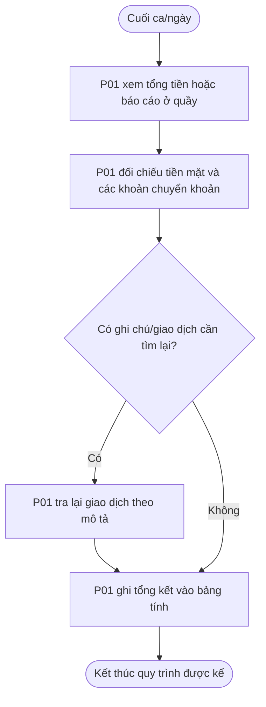

# AS-04 — As-is: Đối soát doanh thu cuối ngày (chỉ phỏng vấn mô phỏng)

> **SIMULATED / DỮ LIỆU GIẢ LẬP — KHÔNG PHẢI KHẢO SÁT THỰC TẾ.** Tất cả nguồn phỏng vấn và quan sát là tình huống AI dựng. Mã E-SIM chỉ trỏ tới nội dung giả lập, không phải bằng chứng hiện trường, lời chứng hay kết quả nghiệm thu. Không đưa các kết luận dưới đây vào báo cáo như đã khảo sát cửa hàng thật.

**Process ID:** AS-SIM-04 · **Actor:** P01 (Owner) · **Source level:** INTERVIEW-ONLY; NO OBSERVATION, NO REAL FIELDWORK.

## Nguồn

[INT-001 – OWN-01, OWN-03, OWN-04, OWN-09, OWN-11, OWN-14](../interviews/records/INT-001-owner.md). P01 nói về kiểm tiền, xem báo cáo quầy, đối chiếu tiền mặt và chuyển khoản, rồi ghi tổng kết bảng tính. Không có biên bản quan sát chốt ca.

**Cảnh báo:** Trình tự và nhánh xử lý là cách *tái dựng từ lời kể*, không phải quy trình quan sát xác nhận. Không có số liệu doanh thu, thời lượng chốt ca, tỷ lệ lệch hay thông số công cụ.

## Đầu vào & đầu ra giả định theo lời kể

| Element | Description | Source |
|---|---|---|
| Input | Báo cáo số tiền từ ứng dụng quầy, tiền mặt, xác nhận chuyển khoản | OWN-03, OWN-04, OWN-09 |
| Action | So khớp và tìm lại giao dịch khi cần | OWN-09, OWN-11 |
| Output | Tổng kết ghi trên bảng tính | OWN-09 |
| Candidate issue | Nhiều bước đối soát, ghi chú thiếu làm việc tra lại khó | F-SIM-001 |

## Chưa xác minh

Không biết định dạng báo cáo, có hay không tự động xuất dữ liệu, cách xử lý hoàn trả, quy tắc tính thuế hoặc sai lệch thanh toán.
