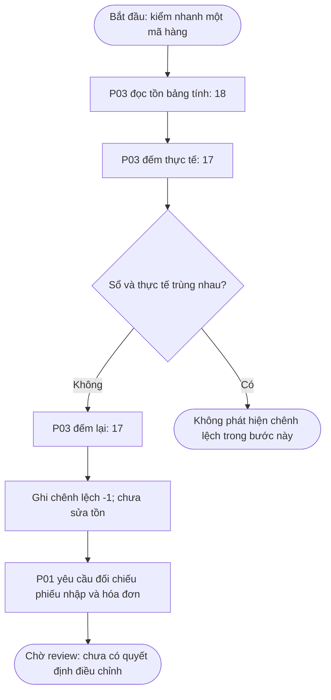

# AS-03 — As-is: Kiểm kê và xử lý chênh lệch tồn (mô phỏng)

> **SIMULATED / DỮ LIỆU GIẢ LẬP — KHÔNG PHẢI KHẢO SÁT THỰC TẾ.** Tất cả nguồn phỏng vấn và quan sát là tình huống AI dựng. Mã E-SIM chỉ trỏ tới nội dung giả lập, không phải bằng chứng hiện trường, lời chứng hay kết quả nghiệm thu. Không đưa các kết luận dưới đây vào báo cáo như đã khảo sát cửa hàng thật.

**Process ID:** AS-SIM-03 · **Actors:** P03 (Warehouse), P01 (Owner) · **Status:** SIMULATED RECONSTRUCTION.

## Nguồn

- [INT-003 – WH-07…WH-10, WH-14…WH-15](../interviews/records/INT-003-warehouse.md).
- [INT-001 – OWN-07](../interviews/records/INT-001-owner.md).
- [OBS-003 – 7 bước](../observations/records/OBS-003-inventory.md).

## Dữ liệu tình huống

Bảng tính giả định ghi tồn **18**, nhân viên đếm được **17**, đếm lại vẫn **17**, chênh lệch **-1**. Chỉ có **ghi nhận chênh lệch và chờ P01 xem xét**. Quan sát không chứng minh tồn đã được điều chỉnh thành 17.

**Nguồn nhánh:** Nhánh không chênh là trường hợp khái quát để đọc sơ đồ, không xảy ra trong OBS-003. P01 **chưa chấp thuận** thay đổi tồn trong kịch bản.

| Step | Actor | Activity | Result | Trace |
|---|---|---|---|---|
| 1 | P03 | Chọn mã hàng | Xác định đối tượng | OBS-003:1 |
| 2 | P03 | Đọc bảng tính | Tồn ghi 18 | OBS-003:2 |
| 3 | P03 | Đếm vật lý | 17 | OBS-003:3 |
| 4 | P03 | Đếm lần hai | 17 | OBS-003:4 |
| 5 | P03 | Ghi -1; không tự sửa | Chờ xác minh | OBS-003:5 |
| 6 | P01 | Yêu cầu đối chiếu chứng từ | Awaiting review | OBS-003:6 |
| 7 | ENG-01 | Ghi note | Bài tập phân tích | OBS-003:7 |

## Vấn đề ứng viên

- P-SIM-05: việc đối chiếu và phê duyệt chênh lệch cần quy trình rõ (F-SIM-005).
- Dữ liệu chưa chứng minh *nguyên nhân* chênh lệch; không kết luận do mất hàng, lỗi nhân viên hoặc lỗi phần mềm.

## Giới hạn

Không biết thời điểm snapshot tồn, cách tính hỏng/hết hạn, kiểm kê nhiều đơn vị, mức lệch được phép hoặc quyền sửa thực tế.
