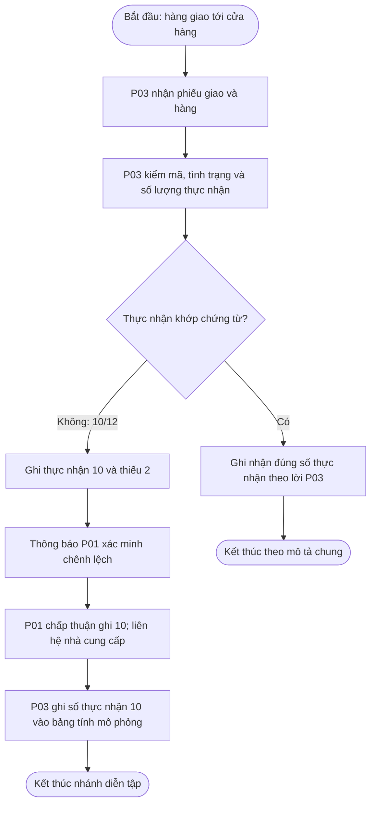

# AS-02 — As-is: Nhận hàng và nhập kho (mô phỏng)

> **SIMULATED / DỮ LIỆU GIẢ LẬP — KHÔNG PHẢI KHẢO SÁT THỰC TẾ.** Tất cả nguồn phỏng vấn và quan sát là tình huống AI dựng. Mã E-SIM chỉ trỏ tới nội dung giả lập, không phải bằng chứng hiện trường, lời chứng hay kết quả nghiệm thu. Không đưa các kết luận dưới đây vào báo cáo như đã khảo sát cửa hàng thật.

**Process ID:** AS-SIM-02 · **Actors:** P03 (Warehouse), P01 (Owner) · **Status:** SIMULATED RECONSTRUCTION.

## Nguồn

- [INT-003 – WH-01…WH-06, PROBE-01](../interviews/records/INT-003-warehouse.md).
- [INT-001 – OWN-06, OWN-15, PROBE-01](../interviews/records/INT-001-owner.md).
- [OBS-002 – 7 bước](../observations/records/OBS-002-purchasing.md).

## Dữ liệu tình huống

Phiếu giao mô phỏng `GH-001` ghi **12 chai**, nhân viên kiểm đếm **10 chai**, số thiếu **2 chai**. P01 đồng ý ghi số thực nhập là 10. Đây **không** phải phiếu giao hoặc số tồn thực tế.

**Chú ý nguồn:** Nhánh “khớp chứng từ” là mô tả tổng quát từ `WH-01…WH-06`, không được diễn tập trong OBS-002. Bước `P01 chấp thuận ghi 10` là một phần kịch bản; **không có xác minh chính sách phê duyệt của cửa hàng thật**.

| Step | Actor | Action | Output | Trace |
|---|---|---|---|---|
| 1 | P03 | Nhận phiếu GH-001 ghi 12 | Phiếu đã nhận | OBS-002:1 |
| 2 | P03 | Kiểm đếm được 10 | Ghi nhận số thực | OBS-002:2 |
| 3 | P03 | Kiểm mã và tình trạng | Không có hàng hỏng trong diễn tập | OBS-002:3 |
| 4 | P03 | Ghi thiếu 2 | Ghi chú chênh lệch | OBS-002:4 |
| 5 | P03/P01 | Thông báo, quyết định hỏi nhà cung cấp | Chờ/tiếp tục theo quyết định | OBS-002:5 |
| 6 | P01 | Đồng ý ghi nhận 10 | Số được chấp thuận | OBS-002:6 |
| 7 | P03 | Điền bảng tính sau xác nhận | Đề xuất tăng tồn 10 | OBS-002:7 |

## Vấn đề ứng viên

- P-SIM-03: chứng từ giao và thực nhận có thể khác nhau, cần phân biệt (F-SIM-004).
- P-SIM-04: nhập dữ liệu nhiều lần và quy tắc phê duyệt cần làm rõ (INT-003 `WH-12`, `WH-14`).

## Chưa chứng minh

Không có giao dịch DB, log cập nhật tồn, mẫu phiếu giao thật, thực thi transaction, tần suất giao thiếu/thừa, quy tắc phê duyệt thật hoặc logic đơn vị thùng/chai. Không suy luận chương trình cần cộng cả 12.
