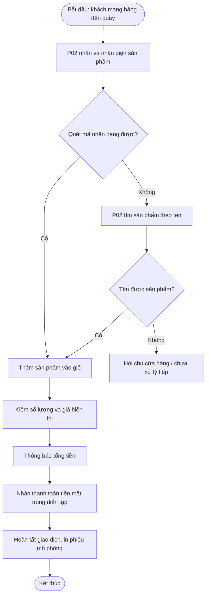

# AS-01 — As-is: Bán hàng tại quầy (mô phỏng)

> **SIMULATED / DỮ LIỆU GIẢ LẬP — KHÔNG PHẢI KHẢO SÁT THỰC TẾ.** Tất cả nguồn phỏng vấn và quan sát là tình huống AI dựng. Mã E-SIM chỉ trỏ tới nội dung giả lập, không phải bằng chứng hiện trường, lời chứng hay kết quả nghiệm thu. Không đưa các kết luận dưới đây vào báo cáo như đã khảo sát cửa hàng thật.

**Process ID:** AS-SIM-01 · **Actor:** P02 (Cashier) · **Status:** SIMULATED RECONSTRUCTION, NOT A VERIFIED CURRENT PROCESS.

## Nguồn

- [INT-002 – CAS-01, CAS-02, CAS-03, CAS-04, CAS-05, CAS-07, CAS-08](../interviews/records/INT-002-cashier.md).
- [OBS-001 – 7 bước diễn tập](../observations/records/OBS-001-sales.md).

## Bối cảnh

Quầy có ứng dụng tính tiền đơn giản (theo vai P01 và P02). Một khách giả lập mua 2 chai nước 12.000đ/chai và 1 snack 9.000đ. Kịch bản chọn thanh toán **tiền mặt**, không mô phỏng xác minh chuyển khoản.

**Lưu ý:** nhánh `Không tìm được sản phẩm` lấy từ lời P02 tại `CAS-06`, không xảy ra trong OBS-001; nhánh này chưa có đường kết thúc được chứng thực. Việc xác nhận tiền đã nhận trong chuyển khoản, trả hàng và hủy hóa đơn **không thuộc luồng OBS-001**.

## Bước tái dựng

| Step | Actor | Input | Action | Output | Trace |
|---|---|---|---|---|---|
| 1 | P02 | 2 nước, 1 snack giả lập | Tiếp nhận hàng | Hàng trên quầy | OBS-001:1 |
| 2 | P02 | Mã hàng giả định | Quét mã, lần thứ 2 mô phỏng quét lỗi | Cần tìm cách khác | OBS-001:2 |
| 3 | P02 | Tên sản phẩm | Tìm tên trên POS mô phỏng | Chọn được sản phẩm | OBS-001:3 |
| 4 | P02 | 2 × 12.000đ + 1 × 9.000đ | Cập nhật giỏ | Tổng 33.000đ | OBS-001:4 |
| 5 | P02 | 50.000đ giả lập | Nhận tiền mặt | Thối 17.000đ | OBS-001:5 |
| 6 | P02 | Giỏ đã chọn | Hoàn tất, in phiếu diễn tập | Phiếu giả lập | OBS-001:6 |
| 7 | ENG-01 | Diễn biến trên | Ghi note | Vấn đề cần kiểm tra thực địa | OBS-001:7 |

## Điểm vướng được gợi ra trong kịch bản

- Mã không quét được cần cách tìm khác (F-SIM-002); **không có đo thời gian**.
- Sai lệch giá yêu cầu hỏi P01, theo `CAS-03`; không có trường hợp sai giá diễn ra trong OBS-001 (F-SIM-006).
- Trường hợp máy in hỏng/in lại hóa đơn được P02 kể, không xảy ra trong quan sát (F-SIM-007).

## Giới hạn

Không suy ra tốc độ POS, tính sẵn sàng của thiết bị thật, cập nhật tồn kho sau bán, thanh toán chuyển khoản hay tính chính xác của hệ thống thật. Không giả định rằng bán thành công tương đương đồng bộ tồn thành công.
