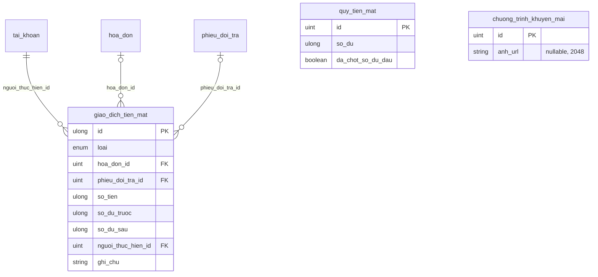

# Đề xuất sửa sổ quỹ và lưu ảnh khuyến mãi

Trạng thái: **Đang review, chưa được duyệt thay đổi CSDL theo #1/#234**. Ngày 23/11/2026. Áp dụng sau ba migration hiện có; không thay migration lịch sử hoặc `schema_v1.sql` đã chốt.

## Vấn đề và xử lý

- POS-12 trước đây ghi `hoan_tien_hoa_don`, hoàn kho và thu hồi điểm nhưng không ghi chi quỹ. Nay ghi `CHI_HUY_HOA_DON` trong cùng transaction. Quỹ thiếu thì toàn bộ thao tác bị rollback; hóa đơn không bị hủy dở. Hóa đơn tiền mặt bằng 0 không tạo giao dịch tiền mặt.
- Quỹ nâng cấp từ dữ liệu cũ có số dư hệ thống 0, không đồng nghĩa tiền trong két bằng 0. Admin kiểm đếm, tạm dừng thu chi, nhập **toàn bộ tiền đang có tại thời điểm chốt**, lý do và xác nhận một lần. Không nhập doanh thu tích lũy, không cộng lại hóa đơn cũ. Ghi chênh lệch và số dư trước/sau; lịch sử cũ được giữ nguyên. Nếu quỹ đã thay đổi từ lúc mở trang, yêu cầu tải lại và kiểm đếm lại.
- Khóa dòng quỹ và unique key bảo vệ mỗi loại giao dịch/hóa đơn hoặc phiếu trả khỏi ghi trùng. Hai trigger từ chối UPDATE/DELETE lịch sử quỹ. Quyền tài khoản DB vẫn cần được quản lý: trigger không bảo vệ khỏi người có quyền DROP TABLE/TRIGGER.
- URL ảnh khuyến mãi được ghi và đọc từ `chuong_trinh_khuyen_mai.anh_url`, ánh xạ `ChuongTrinhKhuyenMai.AnhUrl`. Chương trình cũ có NULL, dùng ảnh thay thế hiện có. Service vẫn kiểm tra HTTP/HTTPS và tối đa 2048 ký tự; không tải URL về máy chủ.

## Migration bổ sung

| Migration | Thay đổi |
|---|---|
| `20261123090000_CashLedgerReconciliation` | `quy_tien_mat.da_chot_so_du_dau` BOOLEAN mặc định FALSE; `giao_dich_tien_mat.ghi_chu` VARCHAR(500) NULL; thêm loại `CHI_HUY_HOA_DON`, `CHOT_SO_DU_DAU`; sửa CHECK liên kết/số tiền; hai unique key và hai trigger bất biến |
| `20261123091000_PromotionImage` | `chuong_trinh_khuyen_mai.anh_url` VARCHAR(2048) NULL |

Không thêm bảng. Giữ ba FK hiện có của sổ quỹ; khoản chi hủy tham chiếu `hoa_don_id`. Giao dịch chốt không có hóa đơn/phiếu trả, bắt buộc ghi chú. `so_tien` của chốt là trị tuyệt đối phần chênh lệch, có thể 0; chiều thay đổi đọc từ số dư trước/sau. Không thay ý nghĩa `CHI_HOAN_TRA`.

## Triển khai và rollback

1. Người phụ trách CSDL duyệt migration; sao lưu DB, thử phục hồi và dừng ghi khi nâng cấp. MySQL DDL không đảm bảo cả chuỗi migration là một transaction.
2. Kiểm tra trùng trước khi áp dụng: `SELECT loai,hoa_don_id,COUNT(*) FROM giao_dich_tien_mat WHERE hoa_don_id IS NOT NULL GROUP BY loai,hoa_don_id HAVING COUNT(*)>1;` và tương tự với `phieu_doi_tra_id`. Nếu có trùng, đối chiếu chứng từ rồi đề xuất xử lý, không xóa lịch sử tự động. Unique key từ chối nâng cấp khi có trùng.
3. Chạy migration bằng cấu hình của môi trường đích đã được kiểm tra. Không dùng database Dev chung để thử các ca ghi.
4. Admin vào `/CashLedger`, đối chiếu và chốt quỹ. Việc chốt được thực hiện bởi người vận hành thực tế, không tự động khi khởi động hoặc migrate.
5. Chạy bán → hủy, bán → trả, đối chiếu kho/điểm/sổ quỹ và báo cáo. Kiểm tra TN bị chặn ở `/CashLedger`, POST thiếu antiforgery bị từ chối.

Down của migration quỹ từ chối khi đã có `CHI_HUY_HOA_DON` hoặc `CHOT_SO_DU_DAU`, nhằm không xóa kiểm toán. Không cưỡng ép rollback bằng DELETE. Với dữ liệu mới, chọn sửa tiến hoặc phục hồi bản sao có kế hoạch. Down ảnh xóa cột ảnh: cần sao lưu trước. Fixture rollback/reapply chỉ dùng database tạm.

## Đối chiếu các phát hiện trước

- DB-R01: bổ sung đồng bộ hủy hóa đơn và chi tiền mặt.
- DB-R02: bổ sung thao tác kiểm đếm/chốt có lịch sử, không suy đoán tiền từ quá khứ.
- DB-R03: bổ sung chống trùng ở DB cho hai liên kết nghiệp vụ.
- DB-R04: bổ sung trigger bảo vệ lịch sử sổ quỹ.
- DB-R05: vẫn là một quỹ id=1, chưa quản lý ca hoặc nhiều quầy; không tự mở rộng phạm vi.
- DB-R06/07: vẫn cần nhóm duyệt phiên bản schema và phiên bản MySQL. Báo cáo `reconciliation-20261123/` mô tả snapshot trước các sửa đổi này.

## Liên quan issue tuần 8

Đọc nội dung issue trực tiếp từ GitHub ngày 23/11/2026. Đây là liên hệ phạm vi, không xác nhận issue đã hoàn thành:

| Issue | Liên hệ với đợt sửa |
|---|---|
| #234 – duyệt migration | Hai migration mới phải được #1 duyệt trước khi gộp/áp dụng |
| #246 – KM-06, #250 – BC-11 | Hóa đơn hủy phải bị loại khỏi lượt dùng; sửa sổ quỹ không thay thế lịch sử sử dụng hoặc báo cáo hiệu quả khuyến mãi |
| #248 – BC-09 | Đổi trả dùng `phieu_doi_tra`; hủy hóa đơn dùng `hoan_tien_hoa_don`. Không cộng hai nguồn như cùng một phiếu trả |
| #249 – BC-10 | Điểm thu hồi khi hủy/đổi trả phải phản ánh đúng lịch sử; chưa phải triển khai báo cáo BC-10 |
| #251, #252 | Dùng kết quả kiểm thử và thay đổi schema để cập nhật báo cáo, ERD và sequence diagram; không tự đánh dấu các tài liệu này xong |
| #243/#244/#242/#255 | Cần kiểm thử E2E, CI/deploy, staging và UAT thực tế của các thành viên phụ trách |

Ảnh khuyến mãi và chốt quỹ không được nêu trực tiếp trong các issue chức năng tuần 8 của Trung. Đây là bổ sung/sửa lỗi cần trình bày rõ trong PR và SRS. Trong checkout đang sửa chưa thấy chức năng đầy đủ KM-05/KM-06 hoặc BC-09–11; chưa đối chiếu mọi nhánh khác để kết luận cả repo thiếu.
