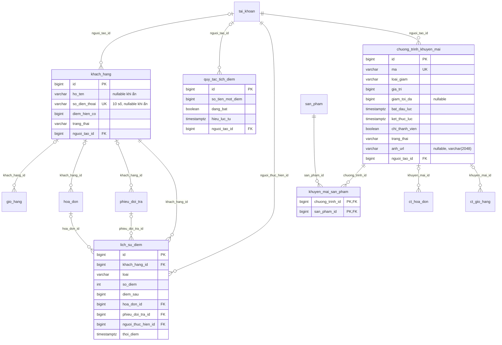

# ERD Khách hàng và Khuyến mãi — phần thiết kế của #251

Trạng thái: **Đang review**, cập nhật 24/11/2026. Căn cứ entity `CuaHangDbContext`, mapping PostgreSQL và `Data/Migrations/Sql/PostgreSqlBaseline.sql` trên `develop` nền `770550c`. Các bảng dưới đây nằm trong schema `smartmart`; không tạo thêm bảng hoặc DbContext trong bản sửa #266.

| Nhóm | Quy tắc liên quan |
|---|---|
| Khách hàng | Khách hoạt động có họ tên và SĐT duy nhất đúng 10 số bắt đầu 0. Ẩn khách xóa thông tin cá nhân, giữ mã tham chiếu giao dịch. Báo cáo Admin dùng nhãn `Khách đã ẩn #id` khi cần. |
| Điểm | Lịch sử chỉ thêm, có loại tích/thu hồi trả/thu hồi hủy/điều chỉnh. Thanh toán và cập nhật điểm cùng transaction. `hoa_don.so_tien_mot_diem` lưu giá trị quy tắc tại lúc bán, **không có FK giả định** từ hóa đơn tới id quy tắc. |
| KM | Sản phẩm–chương trình là N–N qua khóa chính ghép. Dòng hóa đơn lưu chương trình và giảm giá tại lúc bán; không tính báo cáo bằng giá/chính sách hiện tại. |
| Lượt dùng | `v_luot_dung_khuyen_mai` gom theo chương trình + hóa đơn đã thanh toán; hóa đơn hủy không được tính. Đây là view đọc, không là bảng giao dịch mới. |
| Xóa KM | Chặn cả tham chiếu trong giỏ và hóa đơn mọi trạng thái; việc không còn lượt hợp lệ không đồng nghĩa chưa từng có tham chiếu. Xóa liên kết sản phẩm rồi chương trình trong cùng transaction; FK bảo vệ cuộc đua thêm tham chiếu. |

Sơ đồ chọn các cột và quan hệ phục vụ phần KH/KM, không thay thế ERD toàn hệ thống. Xem `docs/db/schema_postgresql.sql`, entity, `CuaHangDbContext.PostgreSql*.cs` và baseline PostgreSQL để biết toàn bộ cột/CHECK/FK. Trường trạng thái/loại dùng varchar với CHECK, không phải MySQL enum; `lich_su_diem.so_diem` vẫn là integer có dấu, còn ID/số dư là bigint. Việc áp baseline vào Supabase đã có dữ liệu cần kế hoạch adoption và người phụ trách CSDL duyệt; tài liệu này không cấp approval.
