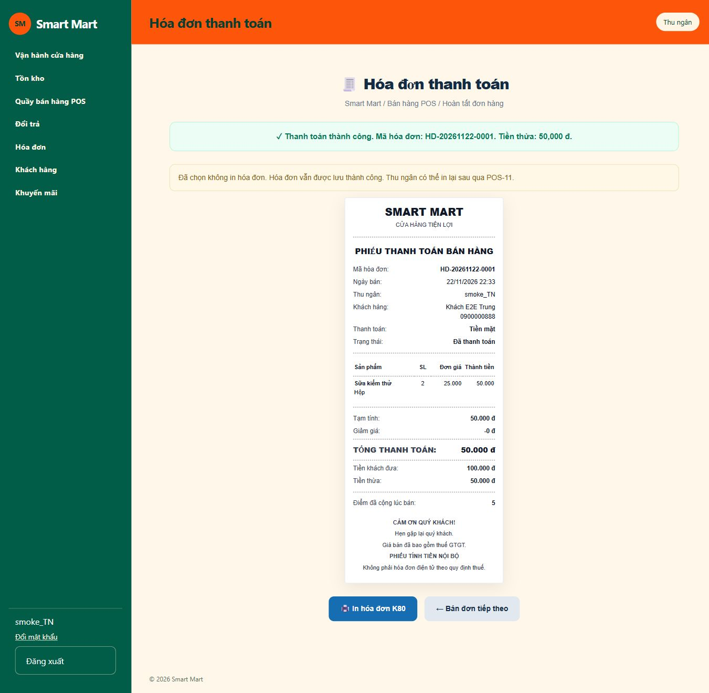
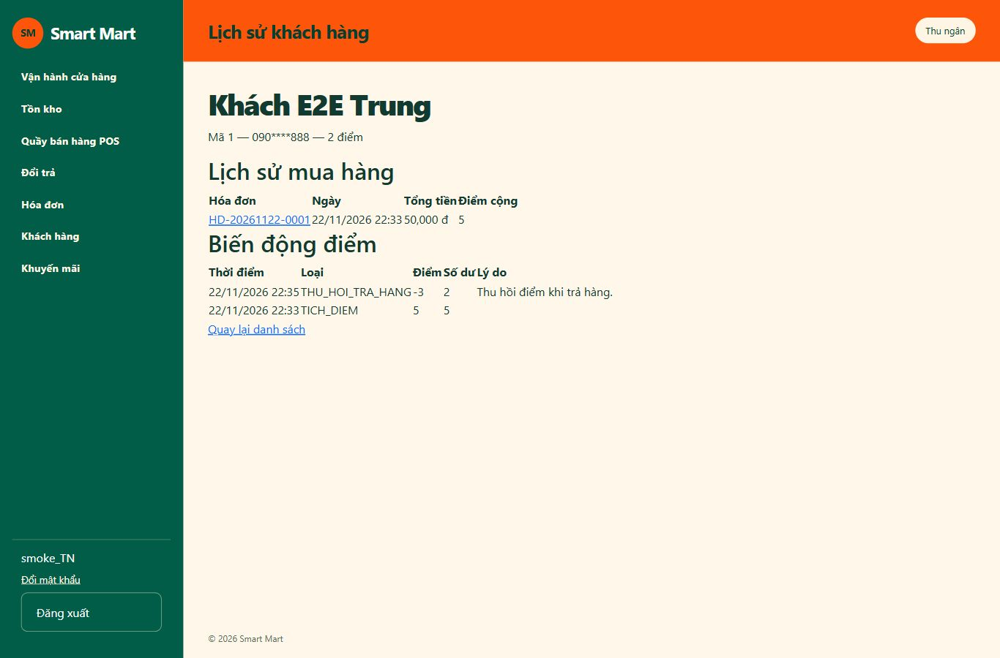
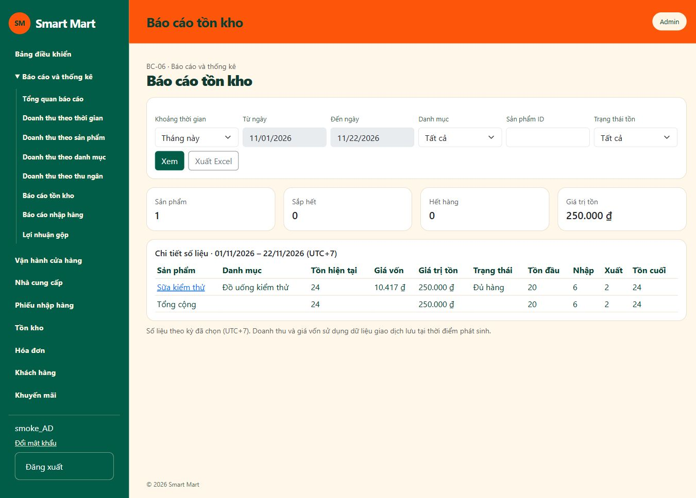

# Tích hợp main/develop — Kiểm thử giao diện và luồng nghiệp vụ

> **Tài liệu lịch sử.** Nội dung ghi lại thời điểm hệ thống còn dùng MySQL (trước 24/11/2026). Từ PR #286 ứng dụng chạy PostgreSQL 17 (`docs/adr/ADR-003-chuyen-csdl-postgresql-supabase.md`); số liệu test, kiểu dữ liệu và câu lệnh MySQL trong tệp này không áp dụng cho bản hiện tại.

> **Trạng thái:** Đang review
>
> **Phụ trách:** #5 Nguyễn Tiến Trung · **Người duyệt:** Chưa có người duyệt độc lập
>
> **PR:** [#232](https://github.com/mongtrucbay02-sys/Convenience-Store-Management-System/pull/232) · **Cập nhật:** 2026-11-22
>
> **Căn cứ:** Mã nguồn và migration hiện hành; [hợp đồng API](../../04-system-design/api/API_CONVENTIONS.md); [schema tham chiếu](../../db/schema_v1.sql). Chưa xác nhận nghiệm thu theo toàn bộ SRS.
>
> **Có dùng AI:** Có — OpenAI Codex; xem [AI-TRUNG-001 đến AI-TRUNG-003](../../09-ai-usage/ai-usage-log.md).

## 1. Phạm vi và phiên bản

- Nhánh: `fix/integrate-main-develop-20261122`.
- Commit tích hợp `12b6415d3b6b169ce3ed454402ee94344ec6a76a`, có hai parent là develop `4b059d3f63f698cf478d97b49f0363c3727dd27f` và main `e5088ede89f400bad21cc8272a067be2dc37a8bd`.
- Commit sửa lỗi sau kiểm thử: **`963294287f579b39185455f2291d6cccdf52916b`**.
- Đã giải quyết 34 mục xung đột giữa hai đầu nhánh trên; giữ AUTH, `CuaHangDbContext`, cấu hình `CuaHang`, KM/BC và giao diện vận hành của develop; bảo toàn bộ tài liệu nhập từ main.
- Kiểm thử trình duyệt tập trung vào một luồng có dữ liệu kiểm soát: bán hàng → tích điểm → trả hàng; nhập hàng → tồn kho → báo cáo. Không tuyên bố mọi ngoại lệ của mọi module đều đã được thao tác thủ công.

## 2. Môi trường và kết quả tự động

Windows, .NET 10, MySQL Community **8.4.13 native**. Database test `cuahang_test_*` được tạo bằng migration thực, tách khỏi Aiven/database dùng chung. Tài khoản AD/TN và mọi dữ liệu trong ảnh đều là dữ liệu kiểm thử.

| Phiên bản | Hạng mục | Kết quả |
|---|---|---|
| `12b6415` | Build | 0 lỗi, 0 cảnh báo |
| `12b6415` | Toàn bộ test | 692 đạt, 0 lỗi, 0 bỏ qua |
| `12b6415` | HTTP smoke với đăng nhập thật | 37 kiểm tra đạt; gồm quyền AD/TN/anonymous và màn hình KM/BC/POS |
| `9632942` | Build | **0 lỗi, 0 cảnh báo** |
| `9632942` | Toàn bộ test | **697 đạt, 0 lỗi, 0 bỏ qua** |
| `9632942` | Hồi quy MySQL mới | 5/5 đạt: ba trường hợp mức giảm tối đa KM, bộ lọc BC, độ chính xác giá vốn BC-06 |

Hai lượt trên là các phiên bản khác nhau, không cộng tổng số test hoặc dùng HTTP smoke của `12b6415` như một lượt chạy HTTP lại đầy đủ tại `9632942`.

Codex đã dùng công cụ để chạy và thu thập kết quả; chưa có thành viên khác xác nhận độc lập. Chín file mã/test sửa trong `9632942` đã được đối chiếu hash với snapshot được build và kiểm thử trước khi commit.

## 3. Luồng đã thao tác qua trình duyệt

| Ca kiểm thử | Kết quả quan sát và đối chiếu |
|---|---|
| Đăng nhập/đăng xuất | TN và AD đăng nhập bằng mật khẩu, dùng cookie phiên thật; đăng xuất quay về trang đăng nhập; menu hiển thị theo vai trò |
| KH-02/POS-03 | Thêm khách tại quầy, tự gắn vào đơn; số điện thoại được che một phần ở danh sách/lịch sử TN |
| Bán và thanh toán | 2 sản phẩm × 25.000đ = 50.000đ; nhận 100.000đ, thừa 50.000đ; hóa đơn đã thanh toán hiển thị thành công |
| KH-06 | MySQL xác nhận tồn 20 → 18, điểm 0 → 5, chỉ một dòng lịch sử cộng điểm |
| Trả hàng | Trả 1 sản phẩm, nhập lại kho, hoàn 25.000đ; tồn 18 → 19, thu hồi 3 điểm, khách còn 2 điểm |
| Nhập hàng | Lập phiếu 5 × 12.000đ = 60.000đ; khi còn nháp tồn vẫn 19; xác nhận nhập thì tồn thành 24 |
| Giá vốn | Sau nhập, giá vốn bình quân lưu là 10.416,67đ; 24 × 10.416,67 = 250.000,08đ |
| BC-02/03/04/05 | Cùng doanh thu thuần 25.000đ; BC-02 gộp 50.000đ, giảm trừ 25.000đ; tiền mặt thu BC-05 là 50.000đ trước khoản hoàn |
| BC-06 | Sau sửa, giá trị tồn hiển thị 250.000đ, dòng tổng cộng khớp vị trí cột; tồn đầu 20 + nhập 6 − xuất 2 = tồn cuối 24 |
| BC-07 | 1 phiếu, 5 đơn vị, tổng giá trị nhập 60.000đ |
| BC-08 | Thuần 25.000đ, giá vốn hàng bán 10.000đ, lợi nhuận gộp 15.000đ, tỷ suất 60%; dùng giá vốn snapshot, không lấy giá vốn mới sau nhập |
| BC-12 | Tải Excel BC-07 từ trình duyệt; kiểm tra cấu trúc workbook và worksheet có dòng tổng 60.000đ; chưa xác minh giao diện Excel/in máy in thật |
| Ngoại lệ ngày | Ngày đảo ngược và khoảng hơn 366 ngày có thông báo; kỳ không có dữ liệu khóa xuất; preset Hôm nay/Tháng trước không bị ngày cũ ghi đè sau sửa |
| Bộ lọc BC | Danh mục/nhà cung cấp có dữ liệu thực và giữ lựa chọn sau khi bấm Xem |
| KM-02 | Trước sửa tái hiện lỗi CHECK khi bỏ trống mức giảm tối đa; sau sửa tạo nháp thành công và không có dữ liệu dở dang từ lượt lỗi |
| Trang chủ | Kiểm tra trực quan ở desktop 1366×900 và mobile 390×844; hero và bốn ảnh sản phẩm tải được; lần đo mobile không tràn ngang |

## 4. Lỗi đã sửa và hồi quy

| Lỗi | Bản sửa |
|---|---|
| Admin mở POS bị 500 do dịch vụ tạm giữ chỉ nhận TN | Các action bán hàng chỉ nhận TN, trả 403 với AD; vẫn giữ action xem/in hóa đơn theo quyền hóa đơn |
| KM không nhập mức giảm tối đa ghi `0`, vi phạm CHECK MySQL | Adapter ghi `NULL` cho create/update; không thay CHECK hoặc migration |
| Dropdown BC chỉ có Tất cả | `ReportFilterService` đọc danh mục/NCC qua EF, gồm bản ghi lịch sử; đăng ký DI và nạp vào view |
| Footer BC còn ghi demo 60 ngày | Bỏ dòng thông tin đã lỗi thời |
| Chọn preset kỳ bị From/To cũ ghi đè | Form chỉ gửi ngày khi chọn Tùy chọn; giữ nguyên cách API xử lý ngày tường minh |
| BC-06 ghi 250.008đ do làm tròn giá vốn quá sớm | Giữ `decimal` qua phép tính tổng, chỉ làm tròn tiền khi hiển thị; sửa dòng tổng cộng lệch cột |

Test mới tại [PosPageAuthorizationTests.cs](../../../tests/ConvenienceStore.Web.Tests/PosPageAuthorizationTests.cs) và [ReportPromotionMySqlRegressionTests.cs](../../../tests/ConvenienceStore.Web.Tests/ReportPromotionMySqlRegressionTests.cs). Tổng 697 ca bao gồm các test cũ của những module khác.

## 5. Bằng chứng và cách kiểm tra lại

Xem [manifest bằng chứng](../evidence/2026-11-22/verification.json): số liệu TRX, các ca hồi quy và SHA-256 của log/TRX/ảnh. Raw TRX, log và các ảnh bổ sung được giữ cục bộ trong `outputs/ui-e2e-20261122/`; không đưa database dump, mật khẩu hoặc chuỗi kết nối thật vào repo.

Ảnh chọn lọc, đều dùng dữ liệu tổng hợp:







Trên môi trường đã có MySQL test riêng và quyền tạo/xóa database, đặt `ConnectionStrings__CuaHangTest` bằng cấu hình test của người chạy rồi thực hiện ở gốc repo:

```powershell
dotnet restore .\tests\ConvenienceStore.Web.Tests\ConvenienceStore.Web.Tests.csproj
dotnet build .\tests\ConvenienceStore.Web.Tests\ConvenienceStore.Web.Tests.csproj --no-restore
dotnet test .\tests\ConvenienceStore.Web.Tests\ConvenienceStore.Web.Tests.csproj --no-build --no-restore --logger trx
```

Tiến trình test không được thừa hưởng cổng web cố định hoặc cấu hình môi trường từ script mở giao diện. Một lượt ban đầu bị nhiễm `ASPNETCORE_URLS` và chế độ Development đã có 60 lỗi; kết quả này được lưu riêng để chẩn đoán, không dùng làm kết quả nghiệm thu. Sau khi tách môi trường, đã chạy lại toàn bộ thành công. Không đổi code module khác để né lỗi do cách chạy đó.

## 6. Giới hạn và checklist PR

- **Ảnh khuyến mãi chưa hoàn thành:** form nhận URL nhưng adapter chưa lưu/đọc; schema hiện không có cột ảnh KM. Chưa thêm migration hoặc xác nhận chức năng này đạt.
- Trang chủ hiện có kệ hàng mẫu tĩnh, không phải danh mục truy vấn từ MySQL.
- Chưa nghiệm thu Aiven/staging, CI, email quên mật khẩu, QR hoặc mọi tình huống đồng thời bằng trình duyệt.
- Trang chủ mobile đã xác minh; lượt kiểm tra báo cáo mobile cuối bị ngắt kết nối công cụ, nên chưa xác nhận toàn bộ màn hình mobile đạt.
- Chưa in tới máy in vật lý. Không có người review/nghiệm thu độc lập.
- Các commit sửa của đợt này không đổi schema hay thêm migration; vẫn dùng migration có sẵn để tạo database test. Không xác nhận thay cho nhóm rằng mọi migration cũ đã được duyệt.
- Các sửa lỗi nhằm đưa hành vi về yêu cầu hiện có, không chủ đích thay đặc tả; chưa sửa hoặc phê duyệt SRS. Các quy tắc về dữ liệu lịch sử/nhãn hiển thị còn cần người review đối chiếu SRS đang có hiệu lực.

| Checklist | Trạng thái có bằng chứng |
|---|---|
| Tự chạy thử, build không lỗi | Đã thực hiện bằng công cụ, kết quả cục bộ như mục 2 |
| Có test | Có test tự động và test hồi quy MySQL |
| Đổi CSDL/migration | Không áp dụng cho các sửa mới; không đổi schema |
| Lệch đặc tả/cập nhật SRS | Không chủ đích đổi đặc tả; chưa cập nhật SRS, chờ reviewer đối chiếu |
| Tài liệu đúng vị trí/trạng thái | Báo cáo tại `docs/06-testing/`, trạng thái Đang review |
| Có dùng AI và ghi nhật ký | Đã ghi AI-TRUNG-001…003 |

## 7. Lịch sử thay đổi

| Ngày | Phụ trách | Nội dung |
|---|---|---|
| 2026-11-22 | #5 Nguyễn Tiến Trung; soạn bằng Codex | Tổng hợp kết quả đã chạy, bằng chứng và giới hạn; chờ review độc lập |
