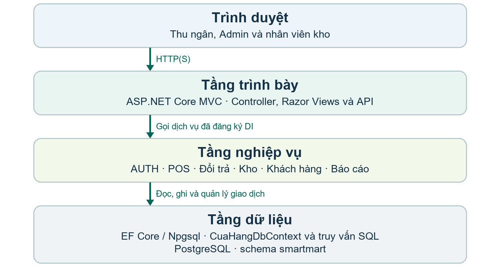
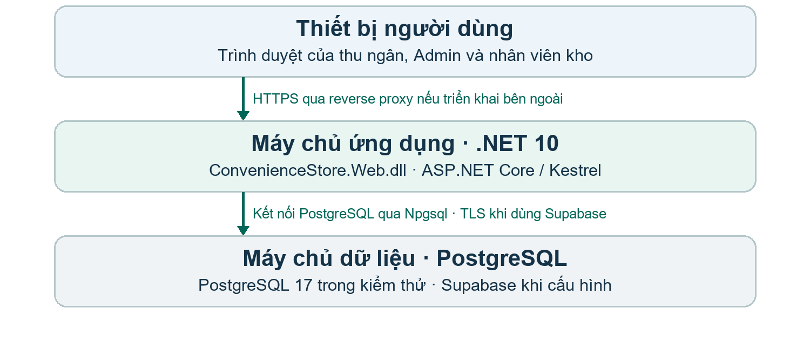
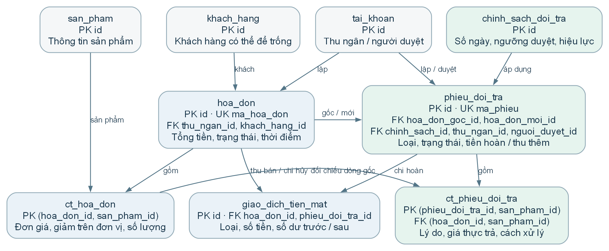
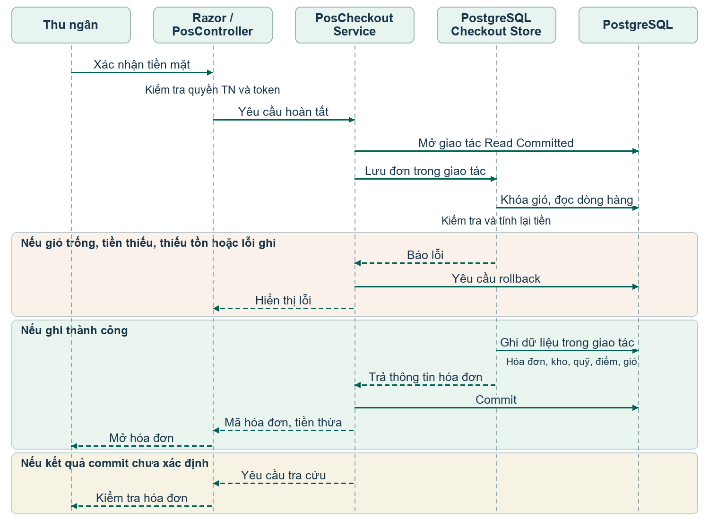
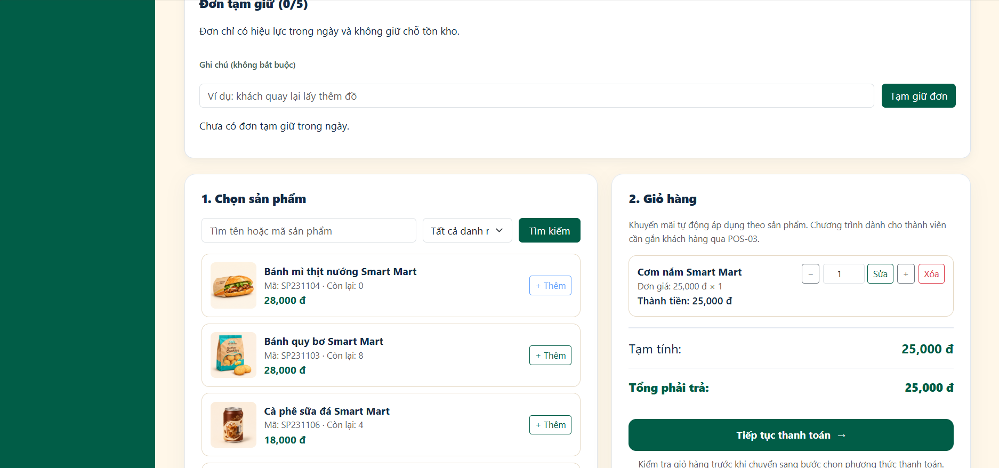
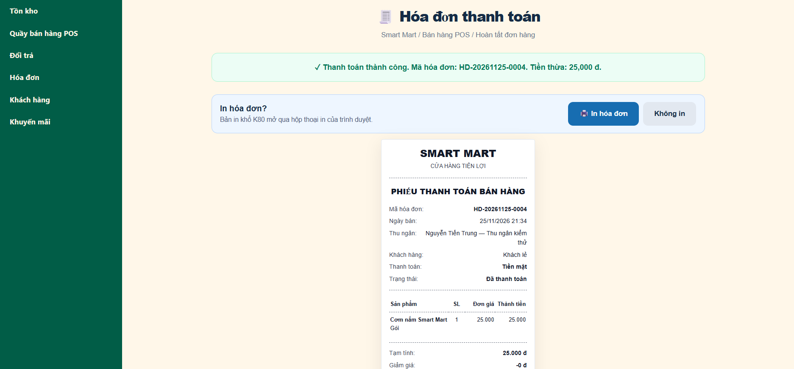
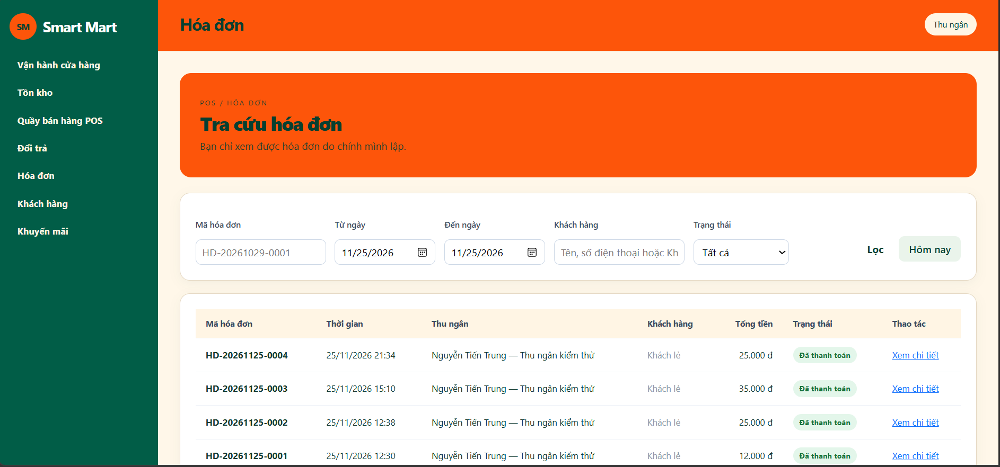
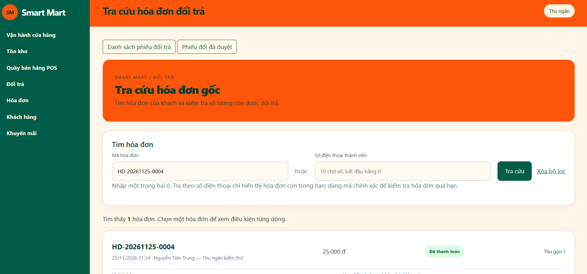

# Báo cáo module Bán hàng và Đổi trả

Ngày đối chiếu 28/11/2026. Người viết báo cáo gốc: Nguyễn Thị Thu Hoài (#240); bản đối chiếu code và bằng chứng được Trung chuẩn bị để Yến và Thăng review, tổng hợp tại #257. Bản Markdown đi cùng `Bao-cao-POS-DT-Smart-Mart-240.docx`; không thay cho quyết định nghiệm thu của nhóm.

## Kết quả và nguồn mã

Bản kết hợp sử dụng develop `cc20336566ff3ac12933e3c1c65c36a6553b2000` và PR #291 tại `ab05ee2fe5dcfa40b7095604aea5f91039376a2f`. Commit code đã kiểm thử: `5ecbd3d55b8c803b30c56f79132379d48da4b94e`. Build Release 0 lỗi, 0 cảnh báo; toàn bộ suite PostgreSQL 17.12 riêng đạt **900/900**, không failed/skipped. Bằng chứng: [verification.json](../06-testing/evidence/2026-11-28/pr291-292/verification.json); TRX gốc lưu cục bộ; chưa có CI của HEAD này.

Giữ các sửa đối soát, decimal và bigint của develop, fix actor/Admin và contract API của #291. Đã bỏ cột snapshot chưa được duyệt; diff schema khớp develop. Đổi thường hoạt động; đổi ngoại lệ bị chặn trước ghi theo #239. Không ghi hoặc DDL Supabase chung.

## Kiến trúc và dữ liệu

Ứng dụng ASP.NET Core MVC trên .NET 10; Razor/HTML và API gọi controller, service xử lý nghiệp vụ, EF Core/Npgsql cùng SQL PostgreSQL truy cập schema `smartmart`. Đây là một ứng dụng chung, không phải các microservice độc lập. Sơ đồ triển khai là mô hình; chưa dùng nó để khẳng định đã triển khai website/staging hay reverse proxy HTTPS.

`hoa_don` có nhiều `ct_hoa_don`; dòng bán lưu tên, giá, giảm giá, giá vốn. `phieu_doi_tra` luôn tham chiếu hóa đơn gốc; hóa đơn mới chỉ có khi phiếu đổi hoàn tất. `ct_phieu_doi_tra` tham chiếu dòng bán gốc, lưu cách xử lý và giá vốn. Quỹ, sổ tiền mặt, tồn và lịch sử điểm liên kết các chứng từ. ERD dưới đây được giữ từ báo cáo gốc và đối chiếu schema PostgreSQL; không phải đề xuất thêm bảng.

## Giao tác POS và Đổi trả

POS-07 khóa giỏ đang bán, kiểm tra hàng và khuyến mãi, ghi hóa đơn/dòng bán, biến động kho, quỹ, điểm và trạng thái giỏ trong cùng transaction. Lỗi trước commit phải rollback; nếu kết quả commit chưa rõ thì tra hóa đơn trước khi thanh toán lại.

DT-03 chỉ cho đổi ngang hoặc cao hơn giá trị hàng trả. Hàng mới ghi doanh thu như hóa đơn bán mới; hàng trả giảm doanh thu theo giá trị từng dòng, kể cả đổi ngang không chi tiền mặt. Chỉ thu chênh lệch và cộng điểm trên số thu thêm; hoàn kho hoặc hủy hàng trả và thu hồi điểm trong cùng giao tác. Riêng đổi hàng ngoại lệ bị chặn trước tạo phiếu cho đến khi thiết kế snapshot được duyệt; phiếu cũ vẫn đọc hoặc từ chối được.

DT-06: AD trực tiếp duyệt và xác nhận chi TRA_HANG, audit ghi đúng AD, lỗi phải rollback. DOI_HANG ngoại lệ tạm chặn cả Create, Approve và Complete do schema chưa lưu phương án. AD vẫn reject phiếu cũ; lịch sử hoàn tất vẫn đọc/in được. Không coi HOLD là đã làm xong yêu cầu snapshot.

DT-07 áp quyền trên cả danh sách, chi tiết và in. Admin xem toàn bộ; thu ngân chỉ xem/in phiếu mình lập, truy cập phiếu của người khác trả 404. Bộ lọc có mã phiếu, ngày, hóa đơn gốc, lý do và trạng thái; không có dữ liệu thì hiện trạng thái rỗng.

## Snapshot phương án đổi và review mới

Quyết định nghiệp vụ vẫn là duyệt toàn bộ phương án đổi. Chưa có thiết kế snapshot được Yến chấp thuận, nên giữ HOLD thay vì dùng giỏ chung, nhét JSON/hash vào ghi chú hoặc dùng file/bộ nhớ. Phiếu cũ chưa hoàn tất không được tự tiêu thụ giỏ hiện tại.

Không có migration/entity/mapping mới trong diff so với develop. Schema baseline 31 bảng/3 view/307 cột giữ nguyên. [Contract và giới hạn hiện tại](../04-system-design/api/returns-dt03-dt06.md). Nhánh schema riêng chỉ là đề xuất; runtime không phụ thuộc nhánh đó.

## Danh sách use case và phạm vi

| Mã | Nội dung | Hiện trạng đối chiếu |
| --- | --- | --- |
| POS-01 | Thêm hàng vào giỏ | Có code; chặn ngừng bán, giá sai, thiếu tồn |
| POS-02 | Sửa số lượng hoặc xóa dòng | Có code; giới hạn giỏ của thu ngân |
| POS-03 | Gắn hoặc gỡ khách | Có code; tính lại ưu đãi thành viên |
| POS-04 | Áp khuyến mãi | Có code; kiểm tra lại khi hoàn tất |
| POS-05 | Thu tiền mặt | Có code; chặn tiền thiếu, tính tiền thừa |
| POS-06 | Phương thức thanh toán khác | Tài liệu API sales ghi đã bỏ; không tuyên bố có QR tự đối soát |
| POS-07 | Hoàn tất bán hàng | Có code và test giao tác |
| POS-08 | Tạm giữ hoặc gọi lại giỏ | Có code; tạm giữ không giữ chỗ tồn |
| POS-09 | Hủy giỏ trước thanh toán | Có code; giữ lịch sử, không phát sinh tồn/quỹ/điểm |
| POS-10 | Tra danh sách hóa đơn | Có code; giới hạn quyền và bộ lọc |
| POS-11 | Chi tiết và in lại hóa đơn | Có code; in lại không tạo giao dịch |
| POS-12 | Hủy hóa đơn đã thanh toán | Có code; Admin, chống hủy lặp, chặn quỹ thiếu |
| DT-01 | Tra hóa đơn gốc | Có code; kiểm tra hóa đơn và số lượng còn trả |
| DT-02 | Lập phiếu trả | Có code; snapshot giá, ngoại lệ chờ duyệt |
| DT-03 | Đổi hàng | Đổi thường có test; đổi ngoại lệ HOLD chờ thiết kế được duyệt |
| DT-04 | Hoàn tiền mặt | Có code; kiểm tra quỹ và chống chi trùng |
| DT-05 | Xử lý hàng trả | Có code; nhập lại hoặc hủy theo dòng |
| DT-06 | Duyệt ngoại lệ | Duyệt TRA_HANG có test; duyệt phương án DOI_HANG HOLD |
| DT-07 | Tra cứu và in lại phiếu | Giữ DT-07 của develop và bổ sung điều hướng; chờ chốt X8 tại #257 |
| DT-08 | Cấu hình chính sách | Không thuộc thay đổi PR #291; không tự quyết định cắt ở báo cáo này |

Thăng/nhóm chốt phạm vi release tại #257. Bản này giữ DT-03 thường và duyệt TRA_HANG, còn duyệt toàn bộ phương án đổi ngoại lệ là HOLD; không tự chốt cắt use case. Không đóng #238/#239 theo kết quả test cục bộ.

## Kiểm thử và giới hạn bằng chứng

Bản hiện tại có 900/900 test toàn suite đạt, không failed/skipped. Gồm actor Admin, transaction/rollback, đổi thường, POS tranh tồn, retry và trả hóa đơn đổi; các ca ngoại lệ xác nhận bị chặn, không phải xác nhận đã triển khai snapshot/reapproval. Có 10 ca login hạn chế theo grant baseline, chưa xác minh live ACL Supabase hoặc exact-role contract của PR #300.

Báo cáo gốc của tác giả ghi 104/104 tại c4d17e6 trên PostgreSQL 17.7. Đây là mốc lịch sử, không phải số test của bản sửa. Kết quả UI MySQL ngày 22/11 cũng chỉ là lịch sử; bốn ảnh dưới đây do nhóm cung cấp ngày 25/11, không phải ảnh chụp lại trên commit mới.

Còn chờ CI GitHub HEAD mới, review độc lập, UAT/staging POS/DT, mẫu MH-20 gốc, quyết định giữ/cắt #257 và đối chiếu tài liệu tại commit release. Chưa đóng #237/#238/#239/#240 chỉ dựa vào lần chạy cục bộ này.

## Ảnh giao diện từ báo cáo gốc

## Tài liệu tham chiếu

- [#240](https://github.com/mongtrucbay02-sys/Convenience-Store-Management-System/issues/240), [#257](https://github.com/mongtrucbay02-sys/Convenience-Store-Management-System/issues/257), [PR #291](https://github.com/mongtrucbay02-sys/Convenience-Store-Management-System/pull/291), [PR #292](https://github.com/mongtrucbay02-sys/Convenience-Store-Management-System/pull/292).
- [SRS tổng hợp](../srs/SRS_ban-cuoi_tong-hop-thay-doi.md), [ma trận nghiệm thu](../06-testing/test-reports/final-acceptance-matrix.md).
- [Schema PostgreSQL](../db/schema_postgresql.sql), [sequence POS 07](../diagrams/pos/POS-07-sequence.md).
