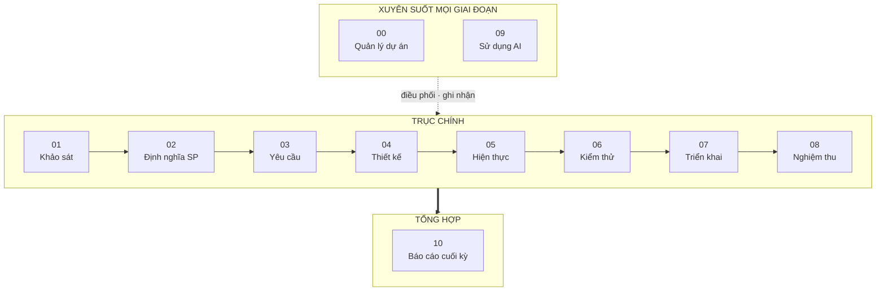

# Hệ thống tài liệu — Convenience Store Management System

Thư mục `docs/` được tổ chức thành **11 khu vực đánh số `00` → `10`**. Số thứ tự phản ánh vị trí của tài liệu trong vòng đời dự án, để bất kỳ ai mở repo cũng biết: tài liệu này sinh ra ở giai đoạn nào, dựa trên tài liệu nào, và sẽ được dùng ở đâu tiếp theo.

## 1. Bản đồ tổng thể



| Nhóm | Thư mục | Vai trò |
|---|---|---|
| **Trục chính** | `01` → `08` | Chuỗi giai đoạn tuần tự. Đầu ra của giai đoạn trước là đầu vào của giai đoạn sau. |
| **Xuyên suốt** | `00-project-management` | Kế hoạch, phân công, biên bản họp, rủi ro, quy ước — áp dụng cho mọi giai đoạn. |
| **Xuyên suốt** | `09-ai-usage` | Nhật ký và đánh giá việc dùng AI ở bất kỳ giai đoạn nào. |
| **Tổng hợp** | `10-final-report` | Báo cáo cuối kỳ, tổng hợp từ `00`–`09`; không tạo nội dung mới mà trích dẫn lại. |

## 2. Danh mục thư mục

| # | Thư mục | Câu hỏi trả lời | Đầu ra chính |
|---|---|---|---|
| 00 | [00-project-management](00-project-management/) | Ai làm gì, khi nào, theo quy ước nào? | Kế hoạch, phân công, biên bản, rủi ro, ma trận truy vết |
| 01 | [01-survey](01-survey/) | Cửa hàng đang vận hành thế nào, vấn đề ở đâu? | Báo cáo khảo sát, quy trình hiện trạng |
| 02 | [02-product-definition](02-product-definition/) | Ta xây sản phẩm gì, cho ai, phạm vi đến đâu? | Tầm nhìn, chân dung người dùng, phạm vi MVP / tầng 2 |
| 03 | [03-requirements](03-requirements/) | Hệ thống phải làm được gì? | SRS, Use Case, quy tắc nghiệp vụ, MoSCoW, NFR |
| 04 | [04-system-design](04-system-design/) | Hệ thống được thiết kế ra sao? | Kiến trúc, CSDL/ERD, hợp đồng API, giao diện |
| 05 | [05-implementation](05-implementation/) | Code được viết và cấu hình thế nào? | Quy ước code, hướng dẫn môi trường, ghi chú module |
| 06 | [06-testing](06-testing/) | Làm sao biết hệ thống đúng? | Kế hoạch kiểm thử, test case, báo cáo kết quả, lỗi |
| 07 | [07-deployment](07-deployment/) | Đưa hệ thống lên môi trường chạy thế nào? | Hướng dẫn triển khai, cấu hình, release notes |
| 08 | [08-validation](08-validation/) | Người dùng/khách hàng có chấp nhận không? | Kịch bản UAT, biên bản nghiệm thu, phản hồi |
| 09 | [09-ai-usage](09-ai-usage/) | AI đã được dùng ở đâu, kiểm chứng ra sao? | Nhật ký dùng AI, chính sách, đánh giá |
| 10 | [10-final-report](10-final-report/) | Dự án đã đạt được gì? | Báo cáo cuối kỳ, slide bảo vệ, phụ lục |

## 3. Cây thư mục

```text
docs/
├── README.md                          ← bạn đang đọc
├── 00-project-management/             [xuyên suốt]
│   ├── README.md
│   ├── traceability-matrix.md         Ma trận truy vết yêu cầu → nghiệm thu
│   └── templates/
│       ├── document-template.md       Mẫu tài liệu
│       └── meeting-minutes.md         Mẫu biên bản họp
├── 01-survey/                         Khảo sát hiện trạng (Giai đoạn 1 — bản GIẢ LẬP)
│   ├── survey-scope.md · survey-plan.md · survey-questionnaire.md     Bước 1–2
│   ├── survey-execution-record.md · evidence-register.md · evidence/  Bước 3
│   ├── interviews/ · observations/    Mẫu + biên bản INT-001…003, OBS-001…003
│   ├── analysis/                      Findings, As-is, Problem Analysis, Problem Statement, bàn giao
│   └── validation/                    Xác minh findings, cổng duyệt Problem Statement
├── 02-product-definition/             Tầm nhìn, người dùng, phạm vi MVP
├── 03-requirements/                   SRS, Use Case, MoSCoW, NFR
├── 04-system-design/
│   ├── api/                           OpenAPI + đặc tả POS, DT, BC, KH, KM
│   ├── database/
│   │   ├── invoice-returns/           ERD Hóa đơn / Đổi trả
│   │   └── product-purchase/          ERD Sản phẩm / Nhập hàng
│   └── ui/QuickMart_UI.zip            Bộ giao diện Figma (SVG)
├── 05-implementation/
│   ├── backend-conventions.md         Quy ước Backend
│   └── attachments/Login.zip          Gói chức năng Đăng nhập (chưa gộp)
├── 06-testing/                        Kế hoạch, test case, báo cáo kiểm thử
├── 07-deployment/                     Hướng dẫn triển khai, release notes
├── 08-validation/                     UAT, biên bản nghiệm thu
├── 09-ai-usage/                       [xuyên suốt]
│   └── ai-usage-log.md                Nhật ký dùng AI
└── 10-final-report/                   [tổng hợp] Báo cáo cuối kỳ, slide
```

Mỗi thư mục đều có `README.md` riêng mô tả: mục đích, đầu vào/đầu ra, tài liệu cần có và tiêu chí hoàn thành.

## 4. Bắt đầu đọc từ đâu

| Bạn là | Đọc trước |
|---|---|
| Thành viên mới | `00-project-management` → `02-product-definition` → `05-implementation/setup` |
| Lập trình viên | `03-requirements` → `04-system-design` (api, database) → `05-implementation/backend-conventions.md` |
| Người kiểm thử | `03-requirements` → `04-system-design/api` → `06-testing` |
| Giảng viên / người review | `00-project-management/traceability-matrix.md` → `10-final-report` |

## 5. Quy ước chung

### 5.1 Đặt tên
- Thư mục và file mới: **chữ thường, kebab-case, không dấu** — ví dụ `use-case-pos.md`, `test-plan.md`.
- Tài liệu gắn module dùng tiền tố mã module: `SP` (Sản phẩm/Danh mục), `NH` (Nhập hàng/NCC), `KHO`, `KH` (Khách hàng), `KM` (Khuyến mãi), `POS` (Bán hàng), `DT` (Đổi trả), `BC` (Báo cáo), `AUTH` (Đăng nhập/phân quyền).
- Tài liệu gắn task giữ mã task trong tiêu đề, ví dụ `# T3-14 — Hợp đồng API POS`.
- Tài liệu chia theo module đặt trong thư mục con của giai đoạn, ví dụ `04-system-design/database/product-purchase/`.

### 5.2 Phần đầu mỗi tài liệu
Mỗi tài liệu Markdown mới mở đầu bằng khối thông tin (xem [mẫu](00-project-management/templates/document-template.md)):

```markdown
> **Trạng thái:** Nháp | Đang review | Đã duyệt | Lỗi thời
> **Phụ trách:** #<số thành viên> <tên> · **Người duyệt:** …
> **Issue/Task:** #… / T…-… · **Cập nhật:** YYYY-MM-DD
> **Căn cứ:** <liên kết tài liệu đầu vào ở giai đoạn trước>
```

### 5.3 Trạng thái tài liệu
| Trạng thái | Ý nghĩa |
|---|---|
| Nháp | Đang viết, chưa dùng làm căn cứ. |
| Đang review | Đã mở PR / chờ người phụ trách duyệt. |
| Đã duyệt | Được dùng làm căn cứ cho giai đoạn sau. |
| Lỗi thời | Đã có bản thay thế; giữ lại để truy vết, ghi rõ bản thay thế. |

### 5.4 Truy vết xuyên giai đoạn
Mỗi yêu cầu phải lần được theo cả hai chiều trên trục chính:

```
Khảo sát (01): INT/OBS → F-SIM (finding) → P-SIM (problem) → PS (problem statement) → N-SIM (need candidate)
  → Định nghĩa sản phẩm (02): FC-SIM (feature candidate) → SC-SIM (scenario) → MVP proposal (I0–I3)
  → Yêu cầu (03): US (user story) → FR (functional requirement) → AC (acceptance criteria) · BR · NFR · UC-CAND
  → Thiết kế (bảng CSDL, endpoint API, màn hình) → Code (module trong src/) → Test case (TC-xx) → Nghiệm thu (UAT-xx)
```

Bảng tổng hợp nằm ở [00-project-management/traceability-matrix.md](00-project-management/traceability-matrix.md). Khi thêm hoặc đổi một yêu cầu, cập nhật dòng tương ứng trong bảng.

### 5.5 Quy trình cập nhật
1. Tài liệu được thêm/sửa qua Pull Request như code; người duyệt theo `.github/CODEOWNERS`.
2. Khi sửa tài liệu ở giai đoạn trước (ví dụ đổi yêu cầu ở `03`), kiểm tra các tài liệu phía sau đang trích dẫn nó (`04`, `06`, `08`).
3. Nếu có dùng AI để tạo/sửa nội dung, ghi một dòng vào [09-ai-usage/ai-usage-log.md](09-ai-usage/ai-usage-log.md).

## 6. Vị trí mới của tài liệu cũ

Lần tái cấu trúc này chỉ **di chuyển** file (giữ nguyên nội dung và lịch sử Git); không có file nào bị xóa.

| Đường dẫn cũ | Đường dẫn mới |
|---|---|
| `docs/api/` | `docs/04-system-design/api/` |
| `docs/database/invoice-returns/` | `docs/04-system-design/database/invoice-returns/` |
| `docs/database/product-purchase/` | `docs/04-system-design/database/product-purchase/` |
| `docs/QuickMart_UI.zip` | `docs/04-system-design/ui/QuickMart_UI.zip` |
| `docs/backend/backend-conventions.md` | `docs/05-implementation/backend-conventions.md` |
| `docs/Login.zip` | `docs/05-implementation/attachments/Login.zip` |
| `MYSQL-REPORTS-SETUP.md` (gốc repo) | `docs/archive/mysql-runtime/mysql-reports-setup.md` (đã lưu trữ) |
