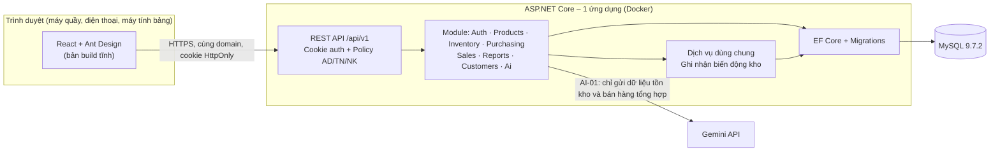

# ADR-001: Lựa chọn tech stack

| | |
|---|---|
| **Dự án** | Hệ thống quản lý cửa hàng tiện lợi – Nhóm 7, học phần INFO2005 Công nghệ phần mềm |
| **Trạng thái** | **Đã chốt** – cả nhóm đã xác nhận (ghi nhận 18/10/2026) |
| **Ngày** | 15/10/2026 |
| **Người đề xuất** | #1 Phạm Gia Thăng |
| **Người xác nhận** | #2 Yến, #3 Hoài, #4 Huy, #5 Trung, #6 Trang |
| **Liên quan** | SRS v1.0.2 mục 2.4, 2.5, 6, 7.2 (vấn đề mở số 2, 3, 9); ERD toàn hệ thống v1; Tài liệu dịch vụ kho bản 1.2 |
| **Cập nhật** | 18/10/2026 · #1: chốt MySQL 9.7.2, MySQL Workbench 26.7.0, provider EF Core, lưu giờ Việt Nam, cấu hình MySQL trong Docker (mục 2.1, 2.2, 3.3, 3.8, 3.10)<br>20/10/2026 · #1: KHO-01, 06, 07 giữ cho #2 theo issue đã gán, kèm quy tắc dự phòng (mục 4); cách chạy test dịch vụ kho trên MySQL thật (mục 3.7); #1 tạo tài khoản Admin đầu tiên (mục 3.8). Các nội dung ngày 20/10 đang chờ nhóm xác nhận |

> Đã chốt: SRS v1.0.3 đã điền mục 2.4 và đóng các vấn đề mở số 2, 3, 9 (mục 7.2).

---

## 1. Bối cảnh

- Sản phẩm là **ứng dụng web**. Thu ngân dùng máy tính tại quầy có trình duyệt; quản lý và nhân viên kho có thể dùng điện thoại hoặc máy tính bảng (SRS 2.4, NFR-TC-02). Không làm ứng dụng desktop cài đặt, không làm ứng dụng di động riêng (Won't).
- Một cửa hàng, 3 vai trò: Admin/Quản lý (AD), Thu ngân (TN), Nhân viên kho (NK).
- Nhóm 6 sinh viên, khoảng 6 tuần lập trình (tuần 4–9). Phạm vi cam kết là **MVP 36 hạng mục** (27 Must + 8 Should + 1 tính năng AI).
- Đã có sẵn:
  - Repo GitHub với project `src/ConvenienceStore.Web` do #5 Trung tạo.
  - ERD toàn hệ thống v1 (18/10/2026, 28 bảng), kèm câu lệnh tạo bảng **MySQL** `schema_v1.sql` (InnoDB, utf8mb4).
  - Quy ước API REST: `/api/v1`, JSON camelCase, lỗi `{ code, message, details }`, mã HTTP 401/403/404/409/422/423.
- Yêu cầu của học phần (Rubric, Project Guidelines): kiến trúc có giải thích (cloud/REST), quản lý trên GitHub, có kiểm thử, có CI, sản phẩm chạy và demo được, có **một tính năng AI nhỏ** và **nhật ký sử dụng AI**.

---

## 2. Quyết định

### 2.1. Tổng quan

| Thành phần | Lựa chọn |
|---|---|
| Kiến trúc | **Monolith chia module** (modular monolith), một repo, triển khai một ứng dụng |
| Máy chủ | **ASP.NET Core Web API** (C#), REST `/api/v1` |
| Truy cập CSDL | **Entity Framework Core** + provider **MySql.EntityFrameworkCore** (Oracle), quản lý thay đổi bằng **migration** |
| CSDL | **MySQL 9.7.2** (dòng LTS); quản trị bằng **MySQL Workbench 26.7.0**. Câu lệnh tạo bảng chỉ dùng tính năng có ở MySQL 8.4, vì Aiven hiện chỉ có 8.4 |
| Giao diện | **React + Vite**, thư viện component **Ant Design** |
| Biểu đồ | Recharts (hoặc biểu đồ đi kèm Ant Design) |
| Xác thực | **Cookie phiên HttpOnly** (ASP.NET Core Cookie Authentication) |
| Phân quyền | Policy theo 3 vai trò AD/TN/NK, kiểm tra ở máy chủ cho mọi API |
| Tài liệu API | **OpenAPI/Swagger** sinh tự động từ controller |
| Kiểm thử | **xUnit** + `WebApplicationFactory` (API, tích hợp); **Playwright** (E2E) |
| Môi trường dev | **Docker Compose** chạy MySQL trên máy từng người |
| CI | **GitHub Actions** |
| Triển khai | **Docker** → Render (web) + Aiven (MySQL). Phương án thay thế: Azure App Service + Azure Database for MySQL (gói Azure for Students) |
| Tính năng AI | **Gemini API**, gọi từ máy chủ, có phương án dự phòng khi AI lỗi |

### 2.2. Phiên bản

Kiểm tra lại khi dựng khung dự án, ghi phiên bản thực tế vào bảng này.

| Thành phần | Phiên bản đề xuất | Phiên bản thực tế |
|---|---|---|
| .NET SDK | .NET 10 (LTS). Nếu project hiện có là .NET 8 thì vẫn dùng được cho đồ án | |
| EF Core + provider MySQL | **MySql.EntityFrameworkCore** (Oracle), bản 10.0.x mới nhất khớp EF Core 10. Đã áp dụng quy tắc dự phòng ở bản trước: tháng 10/2026 Pomelo.EntityFrameworkCore.MySql vẫn chưa có bản cho EF Core 10 | |
| MySQL | **9.7.2** (LTS, ra 28/07/2026); được dùng bản vá 9.7.x mới hơn. MySQL 8.0 đã hết hỗ trợ từ 04/2026 | |
| MySQL Workbench | **26.7.0**, dùng để truy vấn và quản trị. Workbench 26 là bản viết lại, chưa xác nhận có chức năng vẽ ERD; sơ đồ ERD vẽ bằng PlantUML (tệp `.puml` trong `docs/db/`) | |
| Docker image MySQL | `mysql:9.7.2` | |
| Node.js | Bản LTS hiện hành | |
| React / Vite / Ant Design | Bản ổn định mới nhất khi tạo project | |
| Playwright | Bản ổn định mới nhất | |

### 2.3. Sơ đồ thành phần



---

## 3. Chi tiết và lý do từng lựa chọn

### 3.1. Kiến trúc: monolith chia module

- Mỗi module nghiệp vụ là một thư mục riêng trong `Features/`, khớp với 9 module trong SRS và với CODEOWNERS.
- Các module dùng chung một CSDL và một tiến trình. Nghiệp vụ thay đổi tồn kho đi qua **một dịch vụ dùng chung duy nhất** ("Ghi nhận biến động kho"), gọi trong cùng giao tác với chứng từ (hóa đơn, phiếu nhập…).
- **Lý do:** nhập hàng, bán hàng, kiểm kê, đổi trả đều cập nhật tồn kho và giá vốn trong một giao tác. Với monolith, việc này chỉ là một transaction CSDL. Với microservices, nhóm sẽ phải xử lý giao tác phân tán, vượt quá khả năng và thời gian của đồ án.

### 3.2. Máy chủ: ASP.NET Core Web API

- **Lý do:** project `src/ConvenienceStore.Web` đã có sẵn; C# là ngôn ngữ có kiểu chặt, phát hiện lỗi sớm; hỗ trợ sẵn REST, xác thực, phân quyền, OpenAPI, kiểm thử tích hợp.
- Quy ước API giữ nguyên như đã chốt: `/api/v1`, JSON camelCase, phân trang `?page=&size=` trả `{ items, total, page, size }`, lỗi `{ code, message, details }`.

### 3.3. CSDL: MySQL + EF Core migration

- **Lý do:** ERD và câu lệnh tạo bảng đã viết cho MySQL. Migration của EF Core đáp ứng đúng quy tắc của nhóm: *mọi thay đổi cấu trúc CSDL đi qua tệp migration trong PR, #1 duyệt*.
- Quy ước dữ liệu (theo ERD và SRS 6.4):
  - Tên bảng, cột: tiếng Việt không dấu, chữ thường, gạch dưới, danh từ số ít.
  - Tiền bán: số nguyên VND. Giá vốn: `DECIMAL(15,2)`.
  - Thời gian: cột `DATETIME` lưu **giờ Việt Nam** (SRS 6.4, BR-BC-03). Mã nguồn ghi thời điểm tường minh; mỗi kết nối chạy `SET time_zone = '+07:00'` bằng một `DbConnectionInterceptor` (view dùng `NOW()`). *(Sửa ngày 18/10: bản trước ghi "lưu theo UTC hoặc kèm múi giờ", không khớp SRS 6.4.)*
  - Collation `utf8mb4_0900_ai_ci`: không phân biệt hoa thường và không phân biệt dấu (đáp ứng BR-AUTH-06, BR-SP-01).
- Dùng MySQL 9.7.2 (LTS). Câu lệnh tạo bảng chỉ dùng tính năng có ở 8.4 để bản triển khai trên Aiven (chỉ có 8.4) chạy cùng một migration.
- Bước khóa dòng tồn kho viết bằng `FromSql(... FOR UPDATE)`, vì EF Core không có API khóa bi quan (Tài liệu dịch vụ kho bản 1.2, mục 7).

### 3.4. Giao diện: React + Vite + Ant Design

- **Lý do:**
  - Màn hình bán hàng (POS) cần thao tác nhanh trên một trang: tìm sản phẩm, sửa giỏ, tính tiền thừa, không tải lại trang.
  - Ant Design có sẵn bảng, form, hộp thoại, phân trang, thông báo. #6 chỉ cần cấu hình theme (màu, font, khoảng cách) thay vì tự làm design system từ đầu.
  - Responsive sẵn cho điện thoại, máy tính bảng.
- Bản build React được ASP.NET Core phục vụ như file tĩnh, **cùng domain với API**. Khi phát triển, Vite chạy riêng và chuyển tiếp (proxy) `/api` sang máy chủ.
- **In hóa đơn:** trang in riêng dùng CSS `@media print` khổ K80, in qua hộp thoại in của trình duyệt (PA-POS-05.C).
- **Phím tắt** cho thu ngân ở màn hình POS (ví dụ F2 tìm sản phẩm, F9 thanh toán).

### 3.5. Xác thực và phân quyền

- **Cookie phiên HttpOnly, Secure, SameSite=Strict.** Không dùng JWT. Quyết định này đóng **vấn đề mở số 9** trong SRS mục 7.2.
  - Lý do: giao diện và API cùng domain nên không cần token; cookie HttpOnly không đọc được từ JavaScript, an toàn hơn trước tấn công XSS so với lưu JWT trong localStorage; hủy phiên khi đăng xuất hoặc khóa tài khoản đơn giản hơn.
- Phiên hết hạn sau **30 phút** không hoạt động (theo phương án đã chốt).
- Mật khẩu băm bằng `PasswordHasher` của ASP.NET Core. Chính sách: ≥ 8 ký tự, có chữ và số. Sai 5 lần liên tiếp thì khóa tạm 15 phút (PA-AUTH-02.B).
- Phân quyền: 3 policy cài sẵn theo vai trò, gắn vào từng endpoint. **Mọi API đều kiểm tra quyền ở máy chủ** (BR-AUTH-03); giao diện ẩn menu chỉ để tiện dùng, không thay cho kiểm tra ở máy chủ.
- Chống CSRF: dùng antiforgery token của ASP.NET Core cho các yêu cầu thay đổi dữ liệu.

### 3.6. Tài liệu API

- Hợp đồng API được viết trước dưới dạng **bảng endpoint** (theo mẫu Tài liệu dịch vụ kho mục 8.4) để các thành viên làm song song.
- Khi code, Swagger/OpenAPI sinh tự động từ controller là **bản chính thức**; mở tại `/swagger` ở môi trường phát triển.

### 3.7. Kiểm thử

| Loại | Công cụ | Phạm vi | Người chính |
|---|---|---|---|
| Unit test | xUnit | Dịch vụ Ghi nhận biến động kho, tính giá vốn, tính tiền, tích điểm | Người sở hữu module |
| Test API / tích hợp | xUnit + `WebApplicationFactory`, MySQL tạm trong CI | Luồng lõi AUTH, SP, NH, POS | #4 |
| E2E | Playwright | Luồng demo: đăng nhập → nhập hàng → bán hàng → tồn kho → báo cáo | #4 |
| Thủ công | Checklist theo test case | Use case Should, giao diện, tương thích trình duyệt | #4, #6 |

Use case Should và Could chỉ cần test thủ công theo checklist; test tự động dành cho luồng lõi.

**Test dịch vụ Ghi nhận biến động kho chạy trên MySQL thật** (bổ sung 20/10, chờ xác nhận). Không dùng EF Core InMemory hay SQLite, vì dịch vụ dựa vào `SELECT ... FOR UPDATE`, CHECK, trigger chặn sửa/xóa thẻ kho, `ENUM` và `REGEXP_LIKE` của MySQL. Trên máy cá nhân, test dùng MySQL 9.7.2 của Docker Compose (mục 3.8); trong CI, GitHub Actions chạy MySQL `mysql:9.7.2` dạng service container với cùng các cờ. Mỗi lần chạy, bộ test tự tạo một CSDL riêng, dựng bằng migration, chạy test rồi xóa CSDL đó. Không dùng thêm Testcontainers. Chi tiết ở Tài liệu dịch vụ kho bản 1.2, mục 6.

### 3.8. Môi trường phát triển

- `docker-compose.yml` chạy `mysql:9.7.2` trên máy từng người; không dùng chung một CSDL phát triển, để thay đổi của người này không làm hỏng dữ liệu của người khác.
- Lệnh chạy MySQL trong Docker Compose và CI thêm `--default-time-zone=+07:00 --disable-log-bin`. Lý do tắt binary log: khi bật, tài khoản không có quyền SUPER bị lỗi 1419 lúc migration tạo trigger (đã thử ngày 18/10). Máy phát triển không cần binary log.
- Cấu hình qua biến môi trường. Repo chỉ chứa `.env.example`; **không commit `.env`, khóa API hay mật khẩu**.
- Tài khoản Admin đầu tiên: **#1 tạo** bằng chương trình khởi tạo trong mã nguồn. Khi khởi động mà CSDL chưa có tài khoản Admin nào, chương trình đọc tên đăng nhập và mật khẩu tạm từ biến môi trường, băm bằng `PasswordHasher`, đặt `bat_buoc_doi_mk = TRUE` (chi tiết: `auth-giai-thich.md` mục 9.1). Không ghi mật khẩu vào repo hay vào câu lệnh SQL.
- Có script dữ liệu mẫu (#4): dùng Admin ở trên, thêm 1 thu ngân, 1 nhân viên kho, vài danh mục, sản phẩm, nhà cung cấp.

### 3.9. CI/CD

- **GitHub Actions** chạy cho mọi pull request vào `main`:
  1. Build máy chủ (.NET) và build giao diện (React).
  2. Khởi động MySQL tạm, chạy toàn bộ migration trên CSDL trống.
  3. Chạy unit test và test API.
  4. (Từ tuần 6) chạy Playwright cho luồng lõi.
- Nhánh `main` được bảo vệ: chỉ gộp qua PR, cần 1 review và CI đạt.
- Cuối mỗi sprint: gắn tag `sprint-n` và tạo **GitHub Release** (`v0.1`, `v0.2`…, bản cuối `v1.0.0`).
- Triển khai tự động lên môi trường demo khi có Release (continuous delivery ở mức cơ bản). Không làm triển khai liên tục cho từng commit vì dự án chưa cần.

### 3.10. Triển khai

- Đóng gói **một Docker image** gồm máy chủ ASP.NET Core và bản build React.
- **Phương án chính:** web chạy trên Render, CSDL MySQL trên Aiven (gói miễn phí).
- **Phương án thay thế:** Azure App Service + Azure Database for MySQL bằng tín dụng Azure for Students.
- Điều kiện gói miễn phí có thể thay đổi; #4 kiểm tra lại khi đăng ký và ghi vào `docs/DEPLOYMENT.md`.
- Aiven chỉ cho tạo MySQL 8.4 (chưa có 9.x), và luôn bật binary log. Trong tuần 4, #4 thử chạy migration (có trigger) trên Aiven. Nếu không tạo được trigger thì đặt `Database:TaoTrigger = false` cho bản triển khai; quy tắc vẫn được bảo đảm bằng mã nguồn và bộ test CI (CI có trigger). Chi tiết: ERD toàn hệ thống v1 mục 5.
- Cho buổi bảo vệ: có bản deploy, bản chạy trên máy cá nhân bằng Docker Compose, và video demo ghi sẵn.

### 3.11. Tính năng AI trong sản phẩm (AI-01)

- **Chức năng:** gợi ý số lượng nên nhập cho các sản phẩm sắp hết hàng.
- **Dịch vụ:** Gemini API (gói miễn phí), gọi từ máy chủ qua module `Features/Ai`. Khóa API để trong biến môi trường, không bao giờ gửi xuống trình duyệt.
- **Dữ liệu gửi đi:** chỉ tồn hiện tại, ngưỡng tối thiểu, số lượng bán theo ngày trong 2–4 tuần gần nhất, theo mã và tên sản phẩm. **Không gửi** thông tin khách hàng, tài khoản hay giá vốn.
- **Kiểm soát của người dùng:** kết quả ghi rõ "Gợi ý do AI tạo"; quản lý xem, sửa số lượng hoặc bỏ qua; hệ thống không tự tạo phiếu nhập.
- **Dự phòng:** nếu gọi AI lỗi hoặc hết quota, dùng công thức đơn giản (bán trung bình mỗi ngày × số ngày cần dự trữ − tồn hiện tại) và hiển thị rõ đây là kết quả tính theo công thức.
- Chi tiết trong `AI_FEATURE_DESIGN.md`.

### 3.12. Công cụ AI hỗ trợ phát triển

Theo Project Guidelines mục 2A, nhóm khai báo 3 tầng công cụ:

| Tầng | Công cụ | Ghi chú |
|---|---|---|
| Agent chính | *(nhóm điền: GitHub Copilot Student / Claude Code / Codex…)* | |
| Agent dự phòng | Gemini CLI (gói miễn phí) hoặc Cline / Roo Code | |
| Khi hết quota | Ollama hoặc LM Studio với model chạy trên máy; chia nhỏ task và làm thủ công | |

Mọi thay đổi do AI sinh ra phải được người sở hữu module đọc diff, chạy test và giải thích được. Prompt quan trọng và quyết định của nhóm ghi vào `docs/ai-logs/week-xx.md`.

---

## 4. Cấu trúc repo

```
.
├── src/
│   ├── ConvenienceStore.Web/          # ASP.NET Core: API + phục vụ bản build React
│   │   ├── Features/
│   │   │   ├── Auth/                  # #1
│   │   │   ├── Inventory/             # #1: dịch vụ Ghi nhận biến động kho · #2: KHO-01 → KHO-08 (*)
│   │   │   ├── Products/              # #2
│   │   │   ├── Purchasing/            # #2
│   │   │   ├── Sales/                 # #3
│   │   │   ├── Reports/               # #5
│   │   │   ├── Customers/             # #5
│   │   │   └── Ai/                    # #5
│   │   ├── Common/                    # Xử lý lỗi, phân trang, ghi log, phân quyền dùng chung
│   │   └── Data/                      # DbContext, Migrations, dữ liệu mẫu
│   └── client/                        # React + Vite (#3 khung, #6 component dùng chung)
│       └── src/
│           ├── components/            # #6
│           ├── pages/                 # Theo module, cùng người sở hữu với máy chủ
│           └── api/                   # Hàm gọi API
├── tests/
│   ├── ConvenienceStore.Tests/        # xUnit
│   └── e2e/                           # Playwright
├── docs/
│   ├── adr/                           # ADR-001 (file này), ADR-002…
│   ├── ai-logs/                       # week-01.md … week-10.md
│   ├── architecture.md
│   └── DEPLOYMENT.md
├── .github/
│   ├── workflows/ci.yml
│   ├── ISSUE_TEMPLATE/
│   ├── pull_request_template.md
│   └── CODEOWNERS
├── docker-compose.yml
├── Dockerfile
├── .env.example
└── README.md
```

(*) KHO-01, 06, 07 do #2 lập trình, đúng theo issue T-KHO-01, T-KHO-06, T-KHO-07 đã gán (sửa 20/10; bản 18/10 ghi nhầm là #1). Dự phòng: khi máy của một trong hai người (#1 hoặc #2) hết dữ liệu, không làm tiếp được, việc chuyển sang người còn lại; người được giao ban đầu vẫn tham gia chỉnh sửa theo định hướng khi cần.

Vị trí phần giao diện (`src/client` tách riêng hay nằm trong `ConvenienceStore.Web/ClientApp`) do #2, #3 thống nhất khi dựng khung; cập nhật lại sơ đồ trên nếu khác.

---

## 5. Các phương án đã cân nhắc nhưng không chọn

| Phương án | Ưu điểm | Lý do không chọn |
|---|---|---|
| **Microservices** (mỗi module một dịch vụ) | Mở rộng, triển khai độc lập từng phần | Quy mô 1 cửa hàng, 6 sinh viên, 6 tuần. Tồn kho cần giao tác chung giữa nhiều module; tách dịch vụ sinh ra giao tác phân tán, phức tạp thừa (Sommerville Ch.4–5) |
| **Next.js + Supabase + Vercel** (Guidelines khuyến nghị) | Dựng nhanh, có sẵn auth, triển khai dễ | Phải bỏ project .NET đã có, chuyển sang PostgreSQL và viết lại ERD, câu lệnh tạo bảng ở tuần 3 |
| **ASP.NET Core MVC/Razor** (không dùng React) | Ít công nghệ hơn, không cần build giao diện riêng | Màn hình POS cần tương tác nhanh trên một trang; nhóm đã thiết kế theo hướng REST API. **Giữ làm phương án lùi** nếu #3, #6 không quen React |
| **JWT** thay cookie phiên | Phù hợp khi nhiều client, khác domain | Giao diện và API cùng domain; JWT lưu ở trình duyệt dễ lộ hơn và khó thu hồi khi khóa tài khoản |
| **Ứng dụng desktop** (WinForms/WPF) | Cảm giác phần mềm bán hàng truyền thống | Phải cài từng máy, không dùng được trên điện thoại như SRS yêu cầu, không có link demo, không đáp ứng phần cloud/REST của rubric |
| **Một CSDL phát triển dùng chung** | Không cần cài MySQL trên máy | Một người chạy migration lỗi làm hỏng dữ liệu của cả nhóm; Docker Compose cho mỗi người một bản riêng |

---

## 6. Hệ quả

**Tích cực**
- Giao tác tồn kho đơn giản, đúng nghiệp vụ.
- Một lần build, một lần deploy; dễ demo và dễ chạy trên máy cá nhân khi mất mạng.
- Swagger, migration, CI giúp 6 người làm song song mà không phá phần của nhau.
- Có đủ nội dung để giải thích trong báo cáo: monolith/microservices, REST, cloud, bảo mật, kiểm thử, DevOps.

**Tiêu cực, cần lưu ý**
- Nhóm phải dùng 2 ngôn ngữ (C#, JavaScript). Mỗi người chủ yếu làm một phía; cần README quy ước code cho cả hai phía (T3-12, T3-16).
- Phải cài Docker trên máy mỗi người. #4 viết hướng dẫn cài trong README.
- Gói miễn phí của dịch vụ cloud có giới hạn (ngủ khi không dùng, dung lượng nhỏ). Đủ cho demo, không dùng cho vận hành thật.

---

## 7. Việc cần làm sau khi chốt

- [ ] #5 xác nhận phiên bản .NET và loại project hiện có của `src/ConvenienceStore.Web`, điền mục 2.2
- [x] Cả nhóm comment đồng ý trong issue "Chốt tech stack"; đổi trạng thái ADR thành "Đã chốt"
- [x] #1 điền SRS mục 2.4, đóng vấn đề mở số 2, 3, 9 trong SRS mục 7.2 (SRS v1.0.3)
- [ ] #2 dựng khung máy chủ theo mục 4 (T3-11)
- [ ] #3 dựng khung React (T3-15)
- [ ] #4 viết `docker-compose.yml`, `.env.example`, CI (T3-21, T3-18)
- [ ] #6 cấu hình theme Ant Design (T3-28)
- [ ] Cả nhóm điền mục 3.12 (công cụ AI hỗ trợ phát triển)
- [ ] #1 viết chương trình khởi tạo Admin đầu tiên (T4-16) và hạ tầng test dịch vụ kho trên MySQL thật (T4-17); nội dung các unit test thuộc T-KHO-SV
- [ ] #4 thêm MySQL service container vào CI để chạy bộ test dịch vụ kho (T4-02, đã ghi rõ trong Bảng Task ngày 20/10)

---

## 8. Liên hệ lý thuyết (Sommerville, *Engineering Software Products*)

| Khái niệm | Áp dụng trong quyết định này |
|---|---|
| Ch.4 – Kiến trúc phần mềm | Kiến trúc phân tầng, chia module theo nghiệp vụ |
| Ch.5 – Cloud-based software | Triển khai bằng container lên dịch vụ cloud; chọn không dùng microservices và giải thích lý do |
| Ch.6 – Microservices architecture, RESTful services | API REST `/api/v1` theo quy ước chung; so sánh với microservices ở mục 5 |
| Ch.7 – Security and privacy | Cookie HttpOnly, băm mật khẩu, khóa tạm, phân quyền ở máy chủ, không gửi dữ liệu cá nhân cho AI |
| Ch.8 – Reliable programming | Giao tác CSDL cho nghiệp vụ tồn kho, kiểm tra dữ liệu đầu vào, xử lý lỗi thống nhất |
| Ch.9 – Testing | Unit, tích hợp, E2E; test tự động cho luồng lõi |
| Ch.10 – DevOps and code management | GitHub Flow, PR + review, CI, Release theo sprint, Docker |
