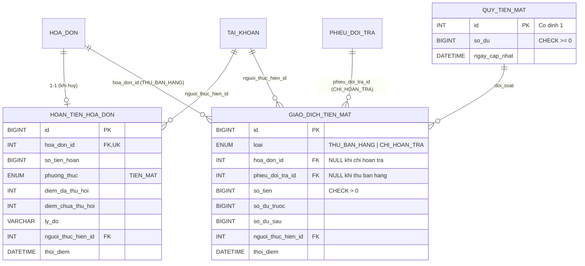

# Đặc tả CSDL Mở rộng – Hoàn tiền hóa đơn và Sổ quỹ tiền mặt

> **Tài liệu phục vụ Issue RFC #273** (Thay đổi yêu cầu CSDL).  
> **Tác giả:** Nguyễn Thị Thu Hoài (#3).  
> **Người duyệt CSDL:** cần ghi nhận approval trên PR trước khi merge.
> **Migration liên quan:** `20261112160000_Pos12CancelInvoice.cs` (PR #217), `20261112170000_CashLedger.cs` (Commit `ea4ecee`).  
> **Tệp DDL đi kèm:** `docs/db/schema_v1_delta_pos12_cashledger.sql`.

> **Phân loại:** phần mở rộng có version của baseline ERD v1; không thay thế
> 28 bảng/10 trigger của baseline và không liên quan tới bảng SQL rời của POS-09 cũ.

---

## 1. Mục đích và phạm vi

Tài liệu này đặc tả chi tiết cấu trúc CSDL mở rộng được bổ sung trong Sprint tuần 7 nhằm đáp ứng:
1. **POS-12 (Hủy hóa đơn đã thanh toán):** Cần bảng lưu vết lịch sử hoàn tiền bất biến (`hoan_tien_hoa_don`) bảo vệ bởi trigger ngăn sửa và xóa.
2. **DT-04 / DT-05 (Đổi trả và hoàn tiền mặt):** Cần quản lý số dư tiền mặt tại quầy (`quy_tien_mat`) và ghi nhận lịch sử thu chi tiền mặt chi tiết (`giao_dich_tien_mat`) có đối soát dòng tiền và kiểm tra số dư không âm.

Thay đổi này phải được liên kết với RFC/issue #273 và được DB Lead duyệt trên pull request. Việc có migration và tài liệu không tự thay thế approval hoặc quy trình merge.

---

## 2. Mô hình thực thể bổ sung (Mermaid ERD)

---

## 3. Từ điển dữ liệu mở rộng

### 3.1. Bảng `hoan_tien_hoa_don`
Lưu vết mỗi hóa đơn bị hủy chỉ được hoàn tiền duy nhất một lần.

| Tên cột | Kiểu dữ liệu | Ràng buộc | Mô tả |
| :--- | :--- | :--- | :--- |
| `id` | `BIGINT UNSIGNED` | `AUTO_INCREMENT, PK` | Khóa chính |
| `hoa_don_id` | `INT UNSIGNED` | `NOT NULL, UNIQUE, FK -> hoa_don(id)` | Hóa đơn được hoàn tiền hủy |
| `so_tien_hoan` | `BIGINT UNSIGNED` | `NOT NULL` | Số tiền mặt thực tế đã hoàn cho khách |
| `phuong_thuc` | `ENUM('TIEN_MAT')` | `NOT NULL DEFAULT 'TIEN_MAT'` | Phương thức hoàn tiền |
| `diem_da_thu_hoi` | `INT UNSIGNED` | `NOT NULL DEFAULT 0` | Số điểm tích lũy của khách đã thu hồi |
| `diem_chua_thu_hoi`| `INT UNSIGNED` | `NOT NULL DEFAULT 0` | Số điểm chưa thu hồi được (nếu khách đã tiêu điểm) |
| `ly_do` | `VARCHAR(255)` | `NOT NULL` | Lý do hủy hóa đơn |
| `nguoi_thuc_hien_id`| `INT UNSIGNED` | `NOT NULL, FK -> tai_khoan(id)` | Quản trị viên thực hiện hủy |
| `thoi_diem` | `DATETIME` | `NOT NULL DEFAULT CURRENT_TIMESTAMP` | Thời điểm ghi nhận |

*Trigger bảo vệ:*
- `trg_hoan_tien_hd_khong_sua`: Báo lỗi `45000` chặn thao tác `UPDATE`.
- `trg_hoan_tien_hd_khong_xoa`: Báo lỗi `45000` chặn thao tác `DELETE`.

---

### 3.2. Bảng `quy_tien_mat`
Lưu số dư tiền mặt tại quầy thu ngân.

| Tên cột | Kiểu dữ liệu | Ràng buộc | Mô tả |
| :--- | :--- | :--- | :--- |
| `id` | `INT UNSIGNED` | `PK` | ID quầy (mặc định quầy chính là 1) |
| `so_du` | `BIGINT UNSIGNED` | `NOT NULL DEFAULT 0, CHECK (so_du >= 0)` | Số dư quỹ thực tế |
| `ngay_cap_nhat` | `DATETIME` | `CURRENT_TIMESTAMP ON UPDATE CURRENT_TIMESTAMP` | Thời điểm thay đổi |

---

### 3.3. Bảng `giao_dich_tien_mat`
Lưu chi tiết từng biến động tăng (thu bán hàng) hoặc giảm (chi hoàn trả).

| Tên cột | Kiểu dữ liệu | Ràng buộc | Mô tả |
| :--- | :--- | :--- | :--- |
| `id` | `BIGINT UNSIGNED` | `AUTO_INCREMENT, PK` | Khóa chính |
| `loai` | `ENUM('THU_BAN_HANG', 'CHI_HOAN_TRA')` | `NOT NULL` | Loại nghiệp vụ |
| `hoa_don_id` | `INT UNSIGNED NULL` | `FK -> hoa_don(id)` | Gắn với hóa đơn khi thu bán hàng |
| `phieu_doi_tra_id`| `INT UNSIGNED NULL` | `FK -> phieu_doi_tra(id)` | Gắn với phiếu trả khi chi hoàn |
| `so_tien` | `BIGINT UNSIGNED` | `NOT NULL, CHECK (so_tien > 0)` | Số tiền giao dịch |
| `so_du_truoc` | `BIGINT UNSIGNED` | `NOT NULL` | Số dư quỹ trước khi phát sinh |
| `so_du_sau` | `BIGINT UNSIGNED` | `NOT NULL` | Số dư quỹ sau khi phát sinh |
| `nguoi_thuc_hien_id`| `INT UNSIGNED` | `NOT NULL, FK -> tai_khoan(id)` | Thu ngân thực hiện |
| `thoi_diem` | `DATETIME` | `NOT NULL DEFAULT CURRENT_TIMESTAMP` | Thời điểm ghi sổ |

*Ràng buộc nghiệp vụ (`ck_gdtm_lien_ket`):*
Bắt buộc đúng ngữ cảnh: Nếu loại là `THU_BAN_HANG` thì `hoa_don_id IS NOT NULL` và `phieu_doi_tra_id IS NULL`. Nếu loại là `CHI_HOAN_TRA` thì `hoa_don_id IS NULL` và `phieu_doi_tra_id IS NOT NULL`.

---

## 4. Đánh giá tính toàn vẹn và Kiểm thử

- **Không ảnh hưởng 28 bảng ERD v1:** Tất cả các bảng trên đều là bảng mở rộng độc lập, liên kết khóa ngoại với các bảng chính (`hoa_don`, `tai_khoan`, `phieu_doi_tra`).
- **An toàn rollback:** Migration có phương thức `Down()` chuẩn để dọn dẹp sạch sẽ khi cần.
- **Bộ test:** Tích hợp trong `PosInvoiceDetailsTests` và `ReturnOrderMySqlTests`; kết quả chạy phải được đính kèm theo PR. Không ghi nhận số lượng test cố định trong đặc tả vì test suite thay đổi theo nhánh.

## 5. Ánh xạ migration và rollback

| Đối tượng | Migration | `Up()` | `Down()` |
| :--- | :--- | :--- | :--- |
| `hoan_tien_hoa_don` | `20261112160000_Pos12CancelInvoice` | Tạo bảng, khóa ngoại và unique key | Xóa bảng sau khi xóa trigger |
| `trg_hoan_tien_hd_khong_sua` | `20261112160000_Pos12CancelInvoice` | Chặn `UPDATE` | `DROP TRIGGER` |
| `trg_hoan_tien_hd_khong_xoa` | `20261112160000_Pos12CancelInvoice` | Chặn `DELETE` | `DROP TRIGGER` |
| `quy_tien_mat` | `20261112170000_CashLedger` | Tạo bảng và seed `id = 1` | Xóa sau `giao_dich_tien_mat` |
| `giao_dich_tien_mat` | `20261112170000_CashLedger` | Tạo bảng, CHECK, index và khóa ngoại | Xóa trước `quy_tien_mat` |

Không sửa migration đã chạy. Mọi thay đổi tiếp theo phải tạo migration mới và cập nhật `schema_v1.sql` trong cùng pull request.

## 6. Checklist trước khi merge

- [ ] Issue/RFC #273 được liên kết với pull request.
- [ ] `docs/db/schema_v1.sql` và DDL delta được cập nhật cùng migration.
- [ ] DB Lead review và approve pull request.
- [ ] Test schema, migration rollback và test nghiệp vụ được chạy; kết quả đính kèm.
- [ ] Không tạo `pos_cancelled_orders` hoặc SQL rời cho POS-09.
