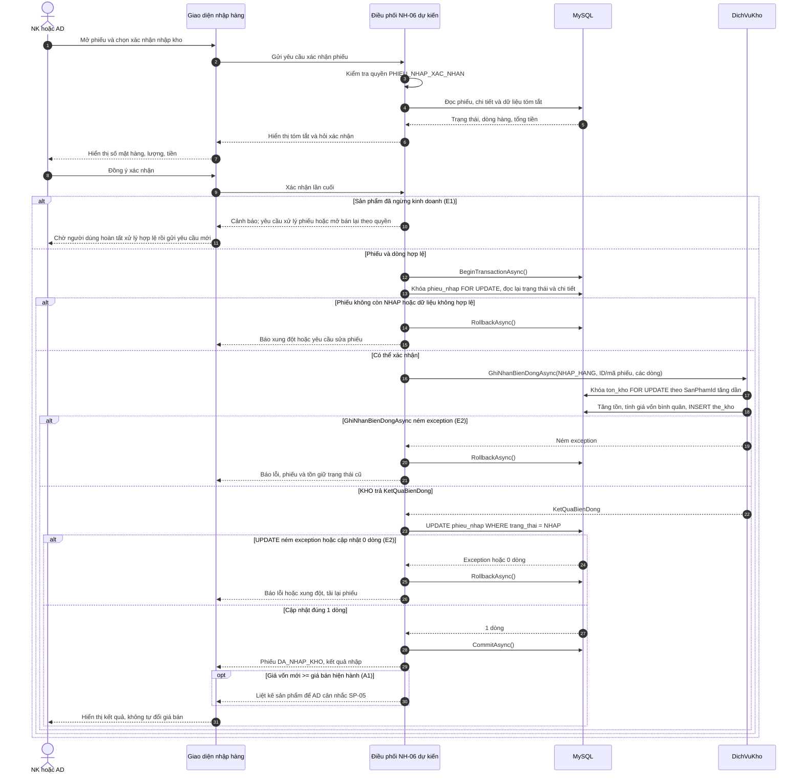
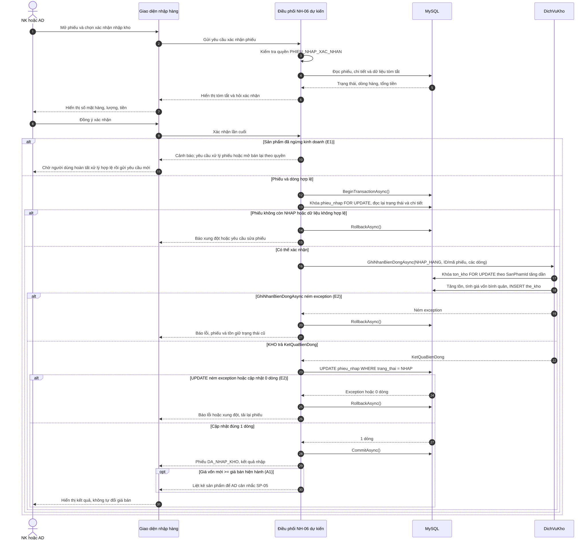

# Sequence Diagram NH-06 — Xác nhận nhập kho

**Nhiệm vụ:** [T6-07, Issue #147](https://github.com/mongtrucbay02-sys/Convenience-Store-Management-System/issues/147). **Căn cứ nghiệp vụ:** [NH-06, Issue #94](https://github.com/mongtrucbay02-sys/Convenience-Store-Management-System/issues/94). Ký hiệu actor → giao diện → bộ điều phối → CSDL → dịch vụ KHO và nhánh `alt` theo [sơ đồ POS-07](../pos/POS-07-sequence.md). Sơ đồ dưới đây là **thiết kế dự kiến**; tên “Điều phối NH-06” không khẳng định đã có một class production tương ứng.

## Mục đích, actor và điều kiện

- **Mục đích:** Chốt phiếu nhập một lần, tăng tồn và tính giá vốn bình quân qua dịch vụ KHO, ghi thẻ kho, rồi chuyển phiếu sang `DA_NHAP_KHO` trong cùng transaction.
- **Actor:** Nhân viên kho (NK) hoặc Admin/Quản lý (AD), cần quyền `PHIEU_NHAP_XAC_NHAN` theo [MaQuyen.cs](../../../src/ConvenienceStore.Web/Modules/Auth/Security/MaQuyen.cs) và [ma trận quyền](../../../src/ConvenienceStore.Web/Modules/Auth/Security/BangQuyen.cs).
- **Tiền điều kiện:** Phiếu `phieu_nhap` đang `NHAP`, có chi tiết hợp lệ; sản phẩm có bản ghi `ton_kho`. Người dùng xem tóm tắt số mặt hàng, tổng số lượng và tổng tiền trước khi xác nhận.
- **Hậu điều kiện thành công:** Phiếu `DA_NHAP_KHO`, có người/thời điểm xác nhận; tồn và giá vốn cập nhật; `the_kho` ghi `NHAP_HANG` theo mã và ID phiếu. Phiếu đã nhập không được sửa/hủy theo BR-NH-04; giá bán không tự đổi.

## Sơ đồ tuần tự — thiết kế dự kiến

## Ảnh xuất và tệp nguồn

Các tệp dưới đây cùng thể hiện **thiết kế dự kiến** ở trên, không phải hành vi production đã xác minh. Khối Mermaid trong tài liệu này và [`sequence-nh-06.mmd`](sequence-nh-06.mmd) là nguồn văn bản; khi sửa luồng cần cập nhật cả hai rồi xuất lại SVG/PNG và đối chiếu tệp Draw.io.

| Định dạng | Tệp | Mục đích |
|---|---|---|
| Mermaid | [sequence-nh-06.mmd](sequence-nh-06.mmd) | Nguồn văn bản, render được bằng Mermaid CLI hoặc GitHub |
| SVG | [sequence-nh-06.svg](sequence-nh-06.svg) | Ảnh vector cho GitHub, Word, PDF |
| PNG | [sequence-nh-06.png](sequence-nh-06.png) | Ảnh raster độ phân giải cao (scale 2×) cho slide và tài liệu |
| Draw.io | [sequence-nh-06.drawio](sequence-nh-06.drawio) | Bản chỉnh sửa được trên diagrams.net (lifeline, connector, frame `alt`/`opt`) |

## Luồng chính, thay thế và ngoại lệ

1. NK/AD mở phiếu `NHAP`, xem tóm tắt và xác nhận. Bên điều phối kiểm tra quyền, dữ liệu phiếu và sản phẩm.
2. Bên điều phối mở transaction, khóa phiếu, kiểm tra lại `NHAP` để chống hai yêu cầu xác nhận cùng phiếu. Gọi [`IDichVuKho.GhiNhanBienDongAsync`](../../../src/ConvenienceStore.Web/Modules/Inventory/Services/IDichVuKho.cs) với `LoaiBienDong.NHAP_HANG` và các `DongBienDong(SoLuong, GiaVon)`.
3. [`DichVuKho`](../../../src/ConvenienceStore.Web/Modules/Inventory/Services/DichVuKho.cs) khóa tồn, cập nhật `ton_kho`, ghi `the_kho` trong transaction do bên gọi mở. Bên điều phối chuyển phiếu có điều kiện sang `DA_NHAP_KHO`, ghi người/thời điểm xác nhận và commit.
4. **A1:** Nếu giá vốn mới ≥ giá bán đang hiệu lực, sau nhập hệ thống liệt kê sản phẩm để AD xem xét SP-05; không tự thay đổi giá bán. Đây là yêu cầu thiết kế, chưa có bằng chứng từ test NH-06 hiện tại.
5. **E1:** Sản phẩm đã ngừng kinh doanh: cảnh báo và dừng lần xác nhận này. Người dùng phải sửa phiếu theo nghiệp vụ hợp lệ (nếu chọn bỏ dòng thì sửa/lưu phiếu riêng) hoặc mở bán lại theo quyền, rồi **gửi yêu cầu xác nhận mới**. Hệ thống không tự động bỏ dòng và không gửi biến động kho cho phiếu chưa hợp lệ.
6. **E2 / yêu cầu trùng:** Lỗi ghi KHO, lỗi cập nhật phiếu hoặc phiếu đã được xác nhận bởi giao dịch khác phải rollback; dữ liệu kho và trạng thái phiếu không được lệch. Không tuyên bố đã test nhánh lỗi NH-06 này.

## Transaction boundary và mapping

Transaction bắt đầu **trước** khi khóa/kiểm tra lại phiếu và gọi KHO, kết thúc **sau** cập nhật trạng thái phiếu. `DichVuKho` yêu cầu `db.Database.CurrentTransaction` và không tự commit. `SELECT ... FOR UPDATE` trên phiếu cùng cập nhật có điều kiện `WHERE trang_thai = 'NHAP'` là thiết kế chống xác nhận lặp; khi cập nhật 0 dòng, rollback và báo xung đột. Bất kỳ lỗi ghi nào cũng rollback toàn bộ transaction.

| Thành phần | Mapping và mức hiện có |
|---|---|
| Phiếu và chi tiết | [`PhieuNhap`](../../../src/ConvenienceStore.Web/Data/Entities/PhieuNhap.cs), [`CtPhieuNhap`](../../../src/ConvenienceStore.Web/Data/Entities/CtPhieuNhap.cs) ↔ `phieu_nhap`, `ct_phieu_nhap`; trạng thái `NHAP`, `DA_NHAP_KHO`, `DA_HUY` trong [SchemaV1.cs](../../../src/ConvenienceStore.Web/Data/Migrations/SchemaV1.cs). |
| Hợp đồng KHO | [`YeuCauBienDong`](../../../src/ConvenienceStore.Web/Modules/Inventory/Models/YeuCauBienDong.cs), [`DongBienDong`](../../../src/ConvenienceStore.Web/Modules/Inventory/Models/DongBienDong.cs), [`LoaiBienDong.NHAP_HANG`](../../../src/ConvenienceStore.Web/Modules/Inventory/Models/LoaiBienDong.cs), `IDichVuKho.GhiNhanBienDongAsync` đã có. |
| Dữ liệu tồn | `ton_kho`, `the_kho`; thuật toán giá vốn bình quân ở [`TinhToanKho`](../../../src/ConvenienceStore.Web/Modules/Inventory/Services/TinhToanKho.cs). |
| Tích hợp đã kiểm tra | [Test NH-06](../../../tests/ConvenienceStore.Web.Tests/Inventory/TichHopDichVuKhoTests.cs) mô phỏng bằng SQL, gọi trực tiếp KHO, cập nhật phiếu và commit trong một transaction; xem [báo cáo kiểm thử](../../tests/nh-06-kho-integration-verification.md). |

**Ranh giới triển khai:** Baseline source được đối chiếu chưa có controller/service production xác nhận phiếu nhập, kiểm tra sản phẩm ngừng kinh doanh hay cảnh báo giá bán. Sơ đồ phục vụ chương Thiết kế hệ thống; test tích hợp hiện có chỉ xác minh kịch bản service/database thành công được mô phỏng, chưa chứng minh API hoặc giao diện NH-06.
