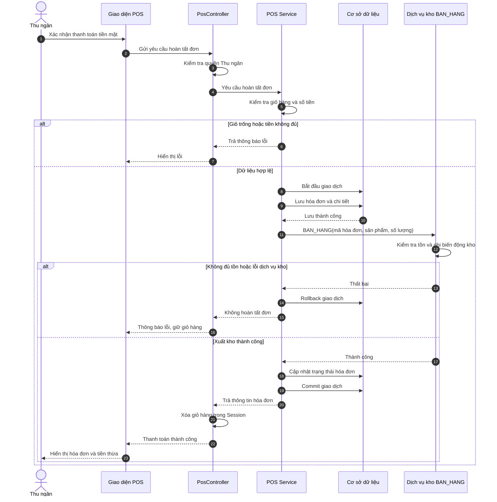

# Sequence Diagram POS-07 – Hoàn tất đơn bán hàng

**Issue:** #38  
**Mã nhiệm vụ:** T4-29  
**Người thực hiện:** Nguyễn Thị Thu Hoài – Developer #3

## 1. Sơ đồ tuần tự POS-07

## 2. Các thành phần tham gia

- **Thu ngân:** Xác nhận thanh toán.
- **Giao diện POS:** Hiển thị đơn hàng và kết quả.
- **PosController:** Tiếp nhận yêu cầu, kiểm tra quyền.
- **POS Service:** Xử lý nghiệp vụ hoàn tất đơn.
- **Cơ sở dữ liệu:** Lưu hóa đơn và chi tiết hóa đơn.
- **Dịch vụ kho BAN_HANG:** Kiểm tra tồn, ghi nhận xuất bán.

## 3. Luồng xử lý chính

1. Thu ngân xác nhận thanh toán tiền mặt.
2. Hệ thống kiểm tra quyền và dữ liệu đơn hàng.
3. POS Service bắt đầu giao dịch và lưu hóa đơn.
4. Gọi dịch vụ kho `BAN_HANG` để xử lý xuất bán.
5. Nếu thành công, hệ thống hoàn tất giao dịch.
6. Xóa giỏ hàng và hiển thị hóa đơn, tiền thừa.

## 4. Các trường hợp ngoại lệ

- **E1:** Giỏ hàng trống.
- **E2:** Tiền khách đưa không đủ.
- **E3:** Sản phẩm không đủ tồn kho.
- **E4:** Lỗi cơ sở dữ liệu hoặc dịch vụ kho.
- **E5:** Người dùng không có quyền Thu ngân.

## 5. Ghi chú triển khai

- Tuần 4: Thiết kế Sequence Diagram POS-07.
- Tuần 5: Lập trình POS-07 chính thức.
- POS-07 phải tích hợp dịch vụ kho `BAN_HANG`.
- Cần thống nhất cơ chế giao dịch và rollback với thành viên #1 và #2.
- Sơ đồ giả định POS và dịch vụ kho tham gia cùng giao dịch CSDL; nếu triển khai thành dịch vụ độc lập, cần điều chỉnh cơ chế xử lý lỗi.

**Related to #38**
